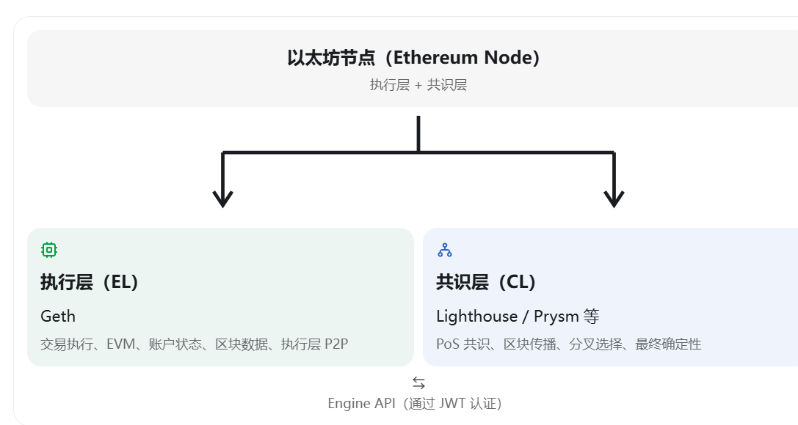
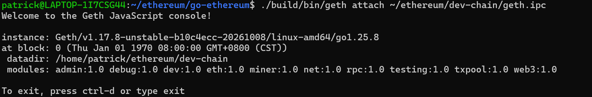
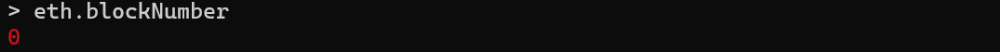
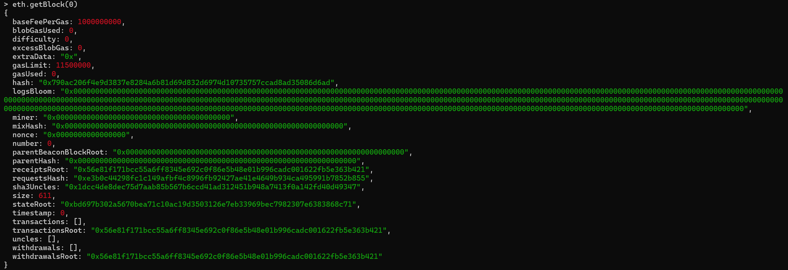
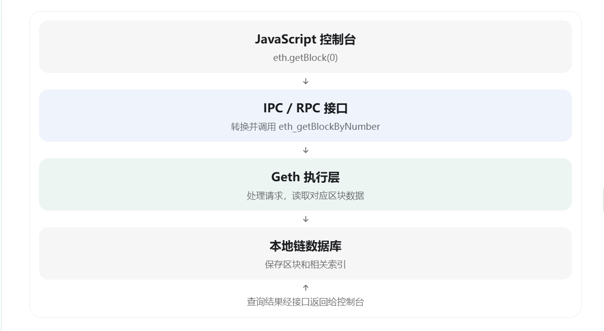
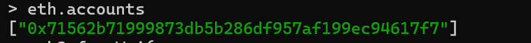
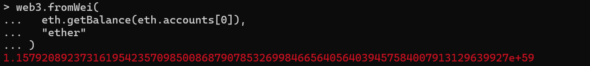

# 第 1 章 运行本地 Geth 开发节点

本章默认已按[准备篇](00-environment-and-installation.md)编译好 Geth，并将源码放在 `~/ethereum/go-ethereum`。

2022 年 9 月 15 日，以太坊完成 The Merge，从 PoW 转换为 PoS。

## 以太坊节点包含什么

合并后的以太坊节点主要由两个客户端组成：



安装的 Geth 负责左边的执行层。

以前在 PoW 时代，单独运行 Geth 就能构成完整节点。今天若想正常运行以太坊主网节点，通常还需要连接一个共识客户端。

这意味着：

- Geth 不负责 PoS 投票和最终确定性。
- Geth 仍然负责验证与执行交易、维护以太坊状态。
- 你不需要质押 32 ETH，也可以运行非验证者的完整节点。
- Geth 目前不提供独立的执行层轻节点同步模式，默认的 Snap 同步也属于全节点同步机制。

## 第一阶段学习目标

运行本地开发链，学会启动 Geth、连接控制台、查看区块和创建交易，理解节点和区块链的基本运行过程。

## 启动第一个 Geth 节点

先不接入主网，而是运行一个本地开发节点。

官方提供的 `--dev` 模式允许 Geth 在本机创建一条独立的实验链，不需要下载主网历史数据，也不需要安装真正的 PoS 共识客户端。

### 第一步 切换工作目录

编译完成后，切换到 go-ethereum 工作目录：

```bash
cd ~/ethereum/go-ethereum
```

### 第二步 创建实验数据目录

```bash
mkdir -p ~/ethereum/dev-chain
```

为什么要单独创建目录？

因为 Geth 不只是一个可执行程序，它还是一个需要存储数据的区块链客户端。节点运行期间可能保存区块、链状态、交易索引以及账户密钥等数据。

我们使用独立目录，是为了以后运行主网或测试网时，不会与这条实验链的数据混在一起。

### 第三步 启动开发链

确保仍然处于 `~/ethereum/go-ethereum` 目录，执行：

```bash
./build/bin/geth --dev \
  --datadir ~/ethereum/dev-chain \
  --dev.period 0 \
  --http \
  --http.addr 127.0.0.1 \
  --http.api eth,net,web3
```

逐个理解这些参数：

| 参数 | 含义 |
| --- | --- |
| `--dev` | 启用本地开发链 |
| `--datadir` | 指定节点数据保存目录 |
| `--dev.period 0` | 有待处理交易时按需生成区块 |
| `--http` | 开启 HTTP JSON-RPC 服务 |
| `--http.addr 127.0.0.1` | 仅监听本机 |
| `--http.api` | 指定允许通过 HTTP 使用的 API |

特别注意 `--dev.period 0`。

它意味着这条实验链不会像真实的以太坊 PoS 主网那样，每 12 秒安排一个 slot，而是在需要处理交易时生成区块。

这也说明开发链只是用来学习执行机制的实验环境，并不等于完整模拟了 PoS 主网共识。

启动成功后，终端中会出现 Geth 的日志。这个终端不要关闭。

### 第四步 连接 Geth 控制台

打开第二个 Ubuntu 终端，执行：

```bash
cd ~/ethereum/go-ethereum
./build/bin/geth attach ~/ethereum/dev-chain/geth.ipc
```

如果成功，你会进入一个交互式环境，大致如下：



这个 `>` 表示你已经进入了 Geth 的 JavaScript 控制台。

理解一个很重要的概念：

- 第一个终端在运行区块链节点。
- 第二个终端在与这个节点通信。

它们通过 IPC（进程间通信）连接。这和以后使用 JSON-RPC 与其他程序连接 Geth 是相似的交互思路。

### 第五步 亲自观察区块链

进入 Geth 控制台后，我们先执行下面这些命令。

#### 实验 1 查看当前区块高度

```javascript
eth.blockNumber
```

`blockNumber` 返回当前本地区块链的最新区块高度。

刚创建开发链时，如果还没有执行交易，通常是 `0`，也就是创世区块。



#### 实验 2 查看创世区块

```javascript
eth.getBlock(0)
```

这里会返回一个区块对象，包含区块哈希、状态根、时间戳、Gas 信息等字段。后面学习以太坊数据结构时，我们会逐个研究。



`eth.getBlock(0)` 背后到底发生了什么？



这就是我们后面要深入理解的内容：一个看起来很简单的 JavaScript 调用，实际上会跨过 RPC、Go 实现代码和区块链数据库等多个层次。

#### 实验 3 查看本地账户

```javascript
eth.accounts
```

在开发模式下，Geth 会准备一个预置资金的开发账户。它不是主网账户里的真实 ETH，而是用于实验的本地测试资金。



#### 实验 4 查看账户余额

```javascript
web3.fromWei(
  eth.getBalance(eth.accounts[0]),
  "ether"
)
```

`eth.getBalance()` 查询余额，原始单位是 Wei。`web3.fromWei()` 将 Wei 转换成 ETH，方便阅读。



## 章节自测

先不看答案，试着用自己的话解释每一题；再对照参考答案，检查自己是否分清了主网与开发链、节点与控制台、区块与账户。

### 题目

1. 为什么主网节点通常需要共识客户端，而本地 `--dev` 模式只启动 Geth 就能做实验？
2. 启动 `--dev.period 0` 后，一分钟没有交易，区块高度会每 12 秒增加吗？
3. 为什么要开两个终端？它们分别做什么？
4. `geth attach ...geth.ipc` 使用 HTTP 还是 IPC？不加 `--http` 还能用吗？
5. 为什么要单独创建 `~/ethereum/dev-chain` 数据目录？
6. `eth.blockNumber` 返回 `0`，表示没有区块吗？`eth.getBlock(0)` 返回什么？
7. `eth.accounts[0]` 指什么？为什么用 `web3.fromWei(..., "ether")`？
8. 开发链账户显示有大量 ETH，能转到主网使用吗？

### 参考答案

1. **Geth 是执行客户端**，负责处理交易、运行智能合约和维护账户状态。PoS 主网还需要**共识客户端**跟踪信标链、确定当前应接在哪条链上，并与执行客户端协作。

   `--dev` 为本地实验模拟了所需的共识配合，让 Geth 可以按需生成区块，所以教程不需要你再安装一个共识客户端。它适合学习交易和执行机制，**不等于真实的 PoS 主网**。

   还要区分“运行节点”和“参与投票”：普通完整节点不需要质押 32 ETH；投票是验证者的职责。

2. **通常不会。`--dev.period 0` 表示这条开发链在有待处理交易时按需出块。**没有交易时，等一分钟也不意味着产生新块。

   主网的情况不同：它每 12 秒进入一个新的 **slot**，这个节奏不由交易数量决定。被选中的验证者可以提出没有交易的区块；也可能有某个 slot 没成功出块。因此，**slot 在推进，不代表区块高度一定每 12 秒加一**。

3. 第一个终端运行 Geth 节点。节点持续维护本地开发链，并等待你向它发送请求，所以这个终端要保持运行。

   第二个终端执行 `geth attach ~/ethereum/dev-chain/geth.ipc`，打开 JavaScript 控制台，让你输入 `eth.blockNumber` 等命令并查看节点的回答。它是在**连接第一个终端里的节点**，没有再启动一条链。

4. 这里使用 **IPC**，意思是同一台电脑上的程序之间通信。可以把 `geth.ipc` 理解为控制台找到本地 Geth 节点的入口。

   `--http` 开启的是**另一个入口**，供程序通过 HTTP 请求访问节点。因此，只要 Geth 的 IPC 入口仍然开启，即使启动时不加 `--http`，这条指定了 `geth.ipc` 的 `attach` 命令仍能连接。你暂时不需要掌握计算机网络，先记住这两个入口是分开的即可。

5. Geth 运行时要保存区块、链的状态和账户密钥等数据。`--datadir ~/ethereum/dev-chain` 告诉它：**这次实验的数据放在这里**。

   以后如果你运行测试网或主网，使用各自的数据目录，就不会把不同链的数据混在一起。

6. **不表示没有区块。高度为 `0` 的是创世区块**，它是这条链的起点。刚创建的开发链即使还没有发送交易，也可以有创世区块。

   `eth.getBlock(0)` 返回一个**区块对象**，其中有区块哈希、状态根、时间戳等区块头字段，也有交易相关信息。它不只是“取得区块头”。开发链的预置账户属于初始状态，可以再用余额查询命令观察。

7. `eth.accounts` 是节点当前列出的账户地址；`[0]` 表示**列表中的第一个地址**。在本章新建的开发链中，它是预置资金的开发账户。`[0]` 只是列表位置，不是以太坊规定的某个固定地址。

   `eth.getBalance(...)` 查到的余额以 **Wei** 为单位，数值通常很长。**1 ETH = 10¹⁸ Wei**。`web3.fromWei(..., "ether")` 只是把它换算成更容易阅读的 ETH 数值，并没有改变账户里的钱。

8. **不能。`--dev` 创建的是你电脑上的独立实验链，这些余额只存在于这条链的账本**中；主网维护自己的账本和余额。

   即使同一个账户地址在两条链上看起来一样，也要分别查询各条链的余额。本地开发链上的测试 ETH 不会因此变成主网上的 ETH。

---

上一章：[准备篇 实验环境与 Geth 安装](00-environment-and-installation.md)

下一章：[第 2 章 发送第一笔 ETH 交易](02-sending-the-first-eth-transaction.md)
