# 第 1 章 运行本地 Geth 开发节点

2022 年 9 月 15 日，以太坊完成 The Merge，从 PoW 转换为 PoS。

## 以太坊节点包含什么

合并后的以太坊节点主要由两个客户端组成：

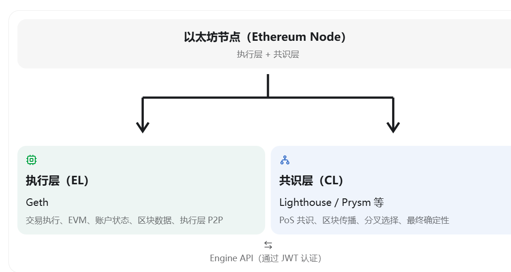

安装的 Geth 负责左边的执行层。

以前在 PoW 时代，单独运行 Geth 就能构成完整节点。今天若想正常运行以太坊主网节点，通常还需要连接一个共识客户端。

这意味着：

- Geth 不负责 PoS 投票和最终确定性。
- Geth 仍然负责验证与执行交易、维护以太坊状态。
- 你不需要质押 32 ETH，也可以运行非验证者的完整节点。
- Geth 目前不提供独立的执行层轻节点同步模式，默认的 Snap 同步也属于全节点同步机制。

## 第一阶段学习目标

运行本地开发链，学会启动 Geth、连接控制台、查看区块和创建交易，理解节点和区块链的基本运行过程。

## 启动第一个 Geth 节点

今天先不接入主网，而是运行一个本地开发节点。

官方提供的 `--dev` 模式允许 Geth 在本机创建一条独立的实验链，不需要下载主网历史数据，也不需要安装真正的 PoS 共识客户端。

### 第一步 切换工作目录

编译完成后，切换到 go-ethereum 工作目录：

```bash
cd ~/ethereum/go-ethereum
```

### 第二步 创建实验数据目录

```bash
mkdir -p ~/ethereum/dev-chain
```

为什么要单独创建目录？

因为 Geth 不只是一个可执行程序，它还是一个需要存储数据的区块链客户端。节点运行期间可能保存区块、链状态、交易索引以及账户密钥等数据。

我们使用独立目录，是为了以后运行主网或测试网时，不会与这条实验链的数据混在一起。

### 第三步 启动开发链

确保仍然处于 `~/ethereum/go-ethereum` 目录，执行：

```bash
./build/bin/geth --dev \
  --datadir ~/ethereum/dev-chain \
  --dev.period 0 \
  --http \
  --http.addr 127.0.0.1 \
  --http.api eth,net,web3
```

逐个理解这些参数：

| 参数 | 含义 |
| --- | --- |
| `--dev` | 启用本地开发链 |
| `--datadir` | 指定节点数据保存目录 |
| `--dev.period 0` | 有待处理交易时按需生成区块 |
| `--http` | 开启 HTTP JSON-RPC 服务 |
| `--http.addr 127.0.0.1` | 仅监听本机 |
| `--http.api` | 指定允许通过 HTTP 使用的 API |

特别注意 `--dev.period 0`。

它意味着这条实验链不会像真实的以太坊 PoS 主网那样，每 12 秒安排一个 slot，而是在需要处理交易时生成区块。

这也说明开发链只是用来学习执行机制的实验环境，并不等于完整模拟了 PoS 主网共识。

启动成功后，终端中会出现 Geth 的日志。这个终端不要关闭。

### 第四步 连接 Geth 控制台

打开第二个 Ubuntu 终端，执行：

```bash
cd ~/ethereum/go-ethereum
./build/bin/geth attach ~/ethereum/dev-chain/geth.ipc
```

如果成功，你会进入一个交互式环境，大致如下：

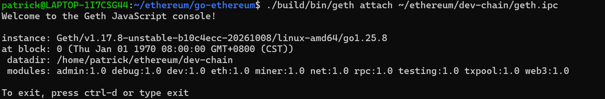

这个 `>` 表示你已经进入了 Geth 的 JavaScript 控制台。

你要理解一个很重要的概念：

- 第一个终端在运行区块链节点。
- 第二个终端在与这个节点通信。

它们通过 IPC（进程间通信）连接。这和以后使用 JSON-RPC 与其他程序连接 Geth 是相似的交互思路。

### 第五步 亲自观察区块链

进入 Geth 控制台后，我们先执行下面这些命令。

#### 实验 1 查看当前区块高度

```javascript
eth.blockNumber
```

`blockNumber` 返回当前本地区块链的最新区块高度。

刚创建开发链时，如果还没有执行交易，通常是 `0`，也就是创世区块。

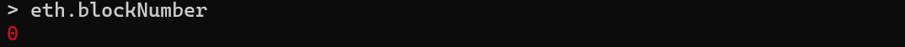

#### 实验 2 查看创世区块

```javascript
eth.getBlock(0)
```

这里会返回一个区块对象，包含区块哈希、状态根、时间戳、Gas 信息等字段。后面学习以太坊数据结构时，我们会逐个研究。

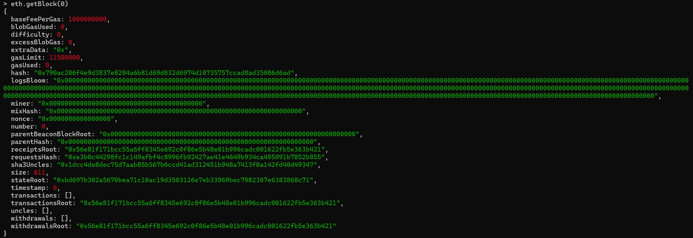

`eth.getBlock(0)` 背后到底发生了什么？

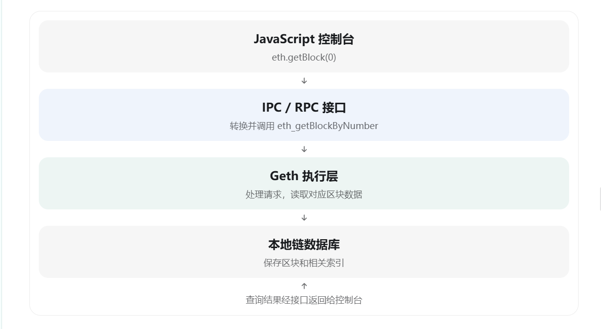

这就是我们后面要深入理解的内容：一个看起来很简单的 JavaScript 调用，实际上会跨过 RPC、Go 实现代码和区块链数据库等多个层次。

#### 实验 3 查看本地账户

```javascript
eth.accounts
```

在开发模式下，Geth 会准备一个预置资金的开发账户。它不是主网账户里的真实 ETH，而是用于实验的本地测试资金。

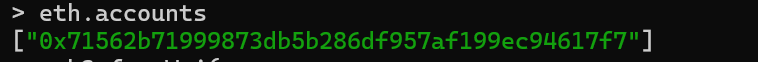

#### 实验 4 查看账户余额

```javascript
web3.fromWei(
  eth.getBalance(eth.accounts[0]),
  "ether"
)
```

`eth.getBalance()` 查询余额，原始单位是 Wei。`web3.fromWei()` 将 Wei 转换成 ETH，方便阅读。

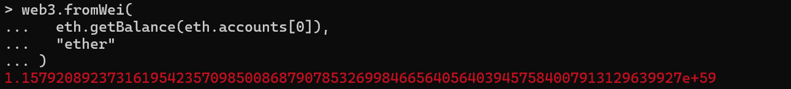

## 发送第一笔 ETH 交易

接下来让开发账户 A 向新创建的收款账户 B 发送 1 ETH。

### 创建收款账户 B

正常来说，创建以太坊账户涉及生成私钥、推导公钥，再从公钥计算账户地址。

根据 [Geth 官方开发模式文档](https://geth.ethereum.org/docs/developers/dapp-developer/dev-mode)，当前教程推荐使用 Clef 创建新账户，而不是依赖旧教程中的 `personal.newAccount()`。本次本地实验使用 Geth 内置的账户管理命令创建一个由密码保护的 Keystore 账户：

```bash
cd ~/ethereum/go-ethereum

./build/bin/geth account new \
  --datadir ~/ethereum/dev-chain
```

按照提示输入密码并再次确认。创建成功后，会返回类似以下信息：


这里有三个知识点：

| 概念 | 解释 |
| --- | --- |
| Private Key | 用来控制账户、签署交易的私钥 |
| Address | 根据公钥推导出的 20 字节地址 |
| Keystore | 使用密码加密保存私钥的文件 |

这个收款账户无需解锁，因为本次实验只让它接收 ETH。

创建完成后，回到 Geth 控制台执行：

```javascript
eth.accounts
```

正常情况下，你应该能看到两个账户：


接着定义两个变量：

```javascript
var sender = eth.accounts[0]
var receiver = eth.accounts[1]
```

检查收款账户的初始余额：

```javascript
eth.getBalance(receiver)
```

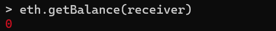

新创建且没有获得过 ETH 的账户，余额应该是 `0`。

> 创建账户本身不是一笔链上交易。它主要是在本地生成密钥并保存到 Keystore，因此通常不会导致区块高度增加。

### 发送 1 ETH

在 Geth JavaScript 控制台中执行：

```javascript
var txHash = eth.sendTransaction({
  from: sender,
  to: receiver,
  value: web3.toWei(1, "ether")
})
```

然后查看交易哈希：

```javascript
txHash
```

如果交易成功提交，会返回一个以 `0x` 开头的 32 字节交易哈希。

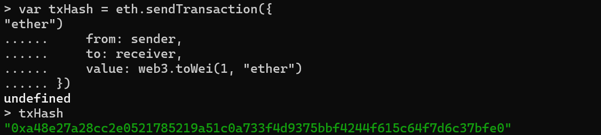

#### 理解交易对象

刚才提交的交易对象包含三个核心字段：

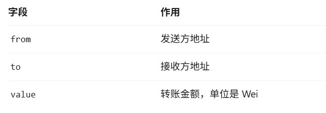

| 字段 | 作用 |
| --- | --- |
| `from` | 发送方地址 |
| `to` | 接收方地址 |
| `value` | 转账金额，单位是 Wei |

为什么不能直接写 `value: 1`？

因为以太坊原生的转账金额单位是 Wei，而不是 ETH。`web3.toWei(1, "ether")` 会将 1 ETH 转换为 `10^18` Wei。

控制台中出现的 `undefined` 并不是报错，而是 JavaScript 的正常行为。例如执行：

```javascript
var sender = eth.accounts[0]
```

这条语句先声明变量 `sender`，再将 `eth.accounts[0]` 的地址赋值给它。但是 `var` 变量声明语句本身不返回具体值，因此控制台显示 `undefined`。

### 查询交易对象

```javascript
eth.getTransaction(txHash)
```

你会看到包含下列字段的交易对象：


重点关注这些字段：

| 字段 | 解释 |
| --- | --- |
| `hash` | 交易哈希 |
| `nonce` | 发送账户的交易序号 |
| `gas` | 允许这笔交易使用的最大 Gas |
| `blockNumber` | 交易被打包进的区块高度 |
| `blockHash` | 包含这笔交易的区块哈希 |
| `transactionIndex` | 交易在区块中的位置 |

其中最值得注意的是 `nonce`。它不是随机数，而是用来区分同一账户发出的不同交易，并帮助防止交易被重复执行。

如果开发账户此前没有发送过交易，第一笔交易的 `nonce` 通常是 `0`，下一笔则是 `1`。

### 查询交易回执

```javascript
eth.getTransactionReceipt(txHash)
```


实际字段的显示形式可能因控制台版本而不同：

- `status: 1` 表示交易执行成功。
- `gasUsed` 表示实际消耗的 Gas。
- `blockNumber` 指向包含这笔交易的区块。

简单的 ETH 转账通常消耗 21,000 Gas，但执行智能合约时的 Gas 消耗会更加复杂。

### 在最新区块中定位交易

先查询最新区块高度：

```javascript
eth.blockNumber
```


然后查询最新区块，并要求 Geth 返回完整交易对象：

```javascript
eth.getBlock("latest", true)
```

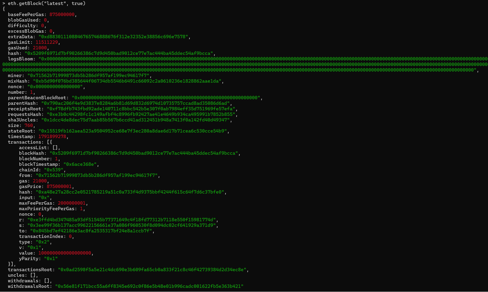

第二个参数 `true` 非常重要：

- `false`：`transactions` 通常只返回交易哈希。
- `true`：`transactions` 返回完整交易对象。

你应该可以在区块的 `transactions` 数组中找到刚才发送的交易。

### 验证余额与 Nonce 变化

首先查询收款账户余额：

```javascript
web3.fromWei(
  eth.getBalance(receiver),
  "ether"
)
```

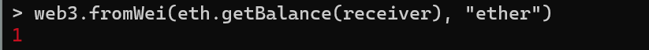

然后查询发送账户已经发出的交易数量：

```javascript
eth.getTransactionCount(sender)
```

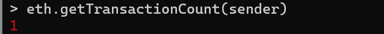

如果这是开发账户的第一笔交易，结果通常是 `1`。

## 理解交易生命周期与 Nonce

当你向 Geth 提交一笔交易时，它不会立即变成已经执行的链上状态。以账户 A 向账户 B 发送 1 ETH 为例，一笔交易通常会经历以下逻辑阶段：


这个图描述的是逻辑流程，不代表进入 TxPool 的交易已经执行。真实 PoS 主网的区块构建、提议和验证还需要共识层参与；当前使用的 `--dev` 链会在本地模拟必要的出块过程。

### Nonce 为什么是必需的

假设账户 A 中有 10 ETH，并准备依次发送三笔交易：

| 交易 | 金额 | Nonce |
| --- | --- | --- |
| 交易 A | 1 ETH | 0 |
| 交易 B | 2 ETH | 1 |
| 交易 C | 3 ETH | 2 |

可以把 Nonce 理解为账户交易的递增序号，但它不是简单的交易 ID，也不是随机数。

对于普通外部账户（EOA），Nonce 表示该账户已经执行过多少笔会增加 Nonce 的交易。假设 Geth 当前记录账户 A 的 Nonce 为 `3`，那么这个账户下一笔正常执行的交易应当使用 Nonce `3`。

### 防止重复执行

Nonce 的一个重要作用是约束同一账户的交易顺序，并防止已执行交易被再次执行。


假设账户 A 已经成功执行一笔 Nonce 为 `0` 的转账。如果完全相同的交易被重复提交，节点可能在交易池校验阶段拒绝它；即使它被放入候选区块，也不能作为该账户下一笔有效交易再次执行。

需要区分两个概念：

1. Nonce 约束同一账户的交易顺序，并防止交易被重复执行。
2. Chain ID 与交易签名机制结合，用来防止交易被简单地跨链重放。

### Nonce 如何影响交易顺序

假设账户当前的 Nonce 为 `3`，但你先提交了 Nonce 为 `5` 的交易：


有些节点会暂时保留这种 Nonce 存在缺口的交易，等待前面的交易到来。节点是否接纳、保留多久，以及将其放在哪个交易池分组中，取决于客户端的交易池规则和配置。

### 动手验证 Nonce

继续使用前面已经发送成功的交易。在 Geth 控制台中查看这笔交易使用的 Nonce：

```javascript
eth.getTransaction(txHash).nonce
```


如果这是预置开发账户发送的第一笔交易，并且此前没有其他交易，你应该看到 `0`。这表示该交易使用了 Nonce `0`。

接着查询当前账户的 Nonce：

```javascript
eth.getTransactionCount(sender)
```


如果这笔交易已经执行成功，并且没有其他交易，你应该看到 `1`。

注意两个结果的区别：

- 交易的 Nonce 是 `0`。
- 账户当前的 Nonce 是 `1`。

这意味着账户下一笔正常交易应当使用 Nonce `1`。

### 查看交易池状态

执行：

```javascript
txpool.status
```

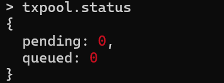

根据 [Geth 官方 txpool 文档](https://geth.ethereum.org/docs/interacting-with-geth/rpc/ns-txpool)，返回值包含两个计数：

- `pending`：目前可供后续区块考虑的待处理交易数量。
- `queued`：暂时无法连续执行、等待未来处理的交易数量。

如果两者都是 `0`，不代表刚才的交易没有经过 TxPool。因为当前使用的是 `--dev.period 0`，Geth 可能已经迅速将交易包含进区块，所以查询时交易池已经为空。
