# 第 2 章 发送第一笔 ETH 交易

本章承接[第 1 章](01-running-a-local-geth-dev-chain.md)的本地开发链环境，继续使用已经运行的 Geth 节点和 JavaScript 控制台。

接下来让开发账户 A 向新创建的收款账户 B 发送 1 ETH。

## 创建收款账户 B

正常来说，创建以太坊账户涉及生成私钥、推导公钥，再从公钥计算账户地址。

根据 [Geth 官方开发模式文档](https://geth.ethereum.org/docs/developers/dapp-developer/dev-mode)，当前教程推荐使用 Clef 创建新账户，而不是依赖旧教程中的 `personal.newAccount()`。本次本地实验使用 Geth 内置的账户管理命令创建一个由密码保护的 Keystore 账户：

```bash
cd ~/ethereum/go-ethereum

./build/bin/geth account new \
  --datadir ~/ethereum/dev-chain
```

按照提示输入密码并再次确认。创建成功后，会返回类似以下信息：

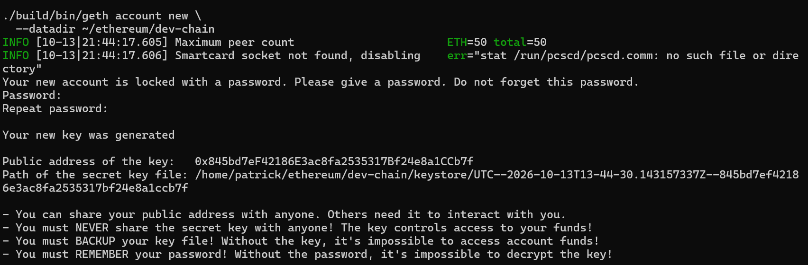

这里有三个知识点：

| 概念 | 解释 |
| --- | --- |
| Private Key | 用来控制账户、签署交易的私钥 |
| Address | 根据公钥推导出的 20 字节地址 |
| Keystore | 使用密码加密保存私钥的文件 |

这个收款账户无需解锁，因为本次实验只让它接收 ETH。

创建完成后，回到 Geth 控制台执行：

```javascript
eth.accounts
```

正常情况下，你应该能看到两个账户：

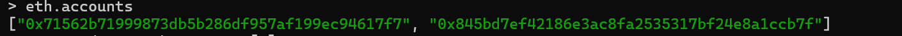

接着定义两个变量：

```javascript
var sender = eth.accounts[0]
var receiver = eth.accounts[1]
```

检查收款账户的初始余额：

```javascript
eth.getBalance(receiver)
```

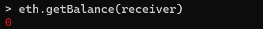

新创建且没有获得过 ETH 的账户，余额应该是 `0`。

> 创建账户本身不是一笔链上交易。它主要是在本地生成密钥并保存到 Keystore，因此通常不会导致区块高度增加。

## 发送 1 ETH

在 Geth JavaScript 控制台中执行：

```javascript
var txHash = eth.sendTransaction({
  from: sender,
  to: receiver,
  value: web3.toWei(1, "ether")
})
```

然后查看交易哈希：

```javascript
txHash
```

如果交易成功提交，会返回一个以 `0x` 开头的 32 字节交易哈希。

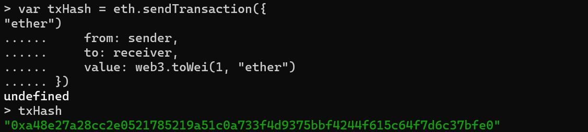

> 请保存**你自己的交易**返回的 `txHash`，第 3、5、6 章还会用到它。截图中的哈希只是本次实验的示例，不能直接照抄；重新连接控制台后，需要用自己保存的哈希恢复变量。

### 理解交易对象

刚才提交的交易对象包含三个核心字段：

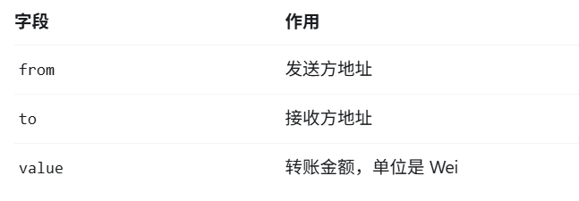

| 字段 | 作用 |
| --- | --- |
| `from` | 发送方地址 |
| `to` | 接收方地址 |
| `value` | 转账金额，单位是 Wei |

为什么不能直接写 `value: 1`？

因为以太坊原生的转账金额单位是 Wei，而不是 ETH。`web3.toWei(1, "ether")` 会将 1 ETH 转换为 `10^18` Wei。

控制台中出现的 `undefined` 并不是报错，而是 JavaScript 的正常行为。例如执行：

```javascript
var sender = eth.accounts[0]
```

这条语句先声明变量 `sender`，再将 `eth.accounts[0]` 的地址赋值给它。但是 `var` 变量声明语句本身不返回具体值，因此控制台显示 `undefined`。

## 查询交易对象

```javascript
eth.getTransaction(txHash)
```

你会看到包含下列字段的交易对象：

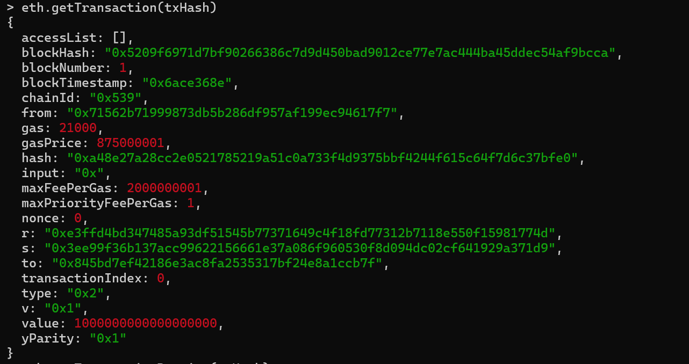

重点关注这些字段：

| 字段 | 解释 |
| --- | --- |
| `hash` | 交易哈希 |
| `nonce` | 发送账户的交易序号 |
| `gas` | 允许这笔交易使用的最大 Gas |
| `blockNumber` | 交易被打包进的区块高度 |
| `blockHash` | 包含这笔交易的区块哈希 |
| `transactionIndex` | 交易在区块中的位置 |

其中最值得注意的是 `nonce`。它不是随机数，而是用来区分同一账户发出的不同交易，并帮助防止交易被重复执行。

如果开发账户此前没有发送过交易，第一笔交易的 `nonce` 通常是 `0`，下一笔则是 `1`。

## 查询交易回执

```javascript
eth.getTransactionReceipt(txHash)
```

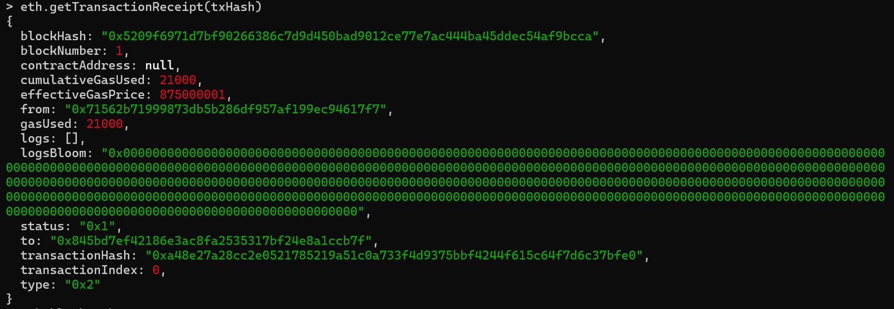

实际字段的显示形式可能因控制台版本而不同：

- `status: 1` 表示交易执行成功。
- `gasUsed` 表示实际消耗的 Gas。
- `blockNumber` 指向包含这笔交易的区块。

简单的 ETH 转账通常消耗 21,000 Gas，但执行智能合约时的 Gas 消耗会更加复杂。

## 在最新区块中定位交易

先查询最新区块高度：

```javascript
eth.blockNumber
```

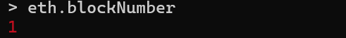

然后查询最新区块，并要求 Geth 返回完整交易对象：

```javascript
eth.getBlock("latest", true)
```

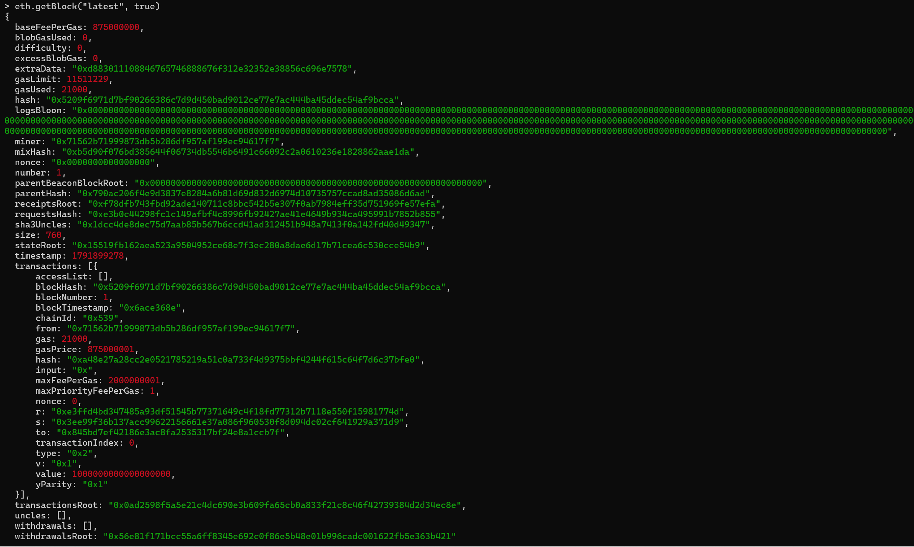

第二个参数 `true` 非常重要：

- `false`：`transactions` 通常只返回交易哈希。
- `true`：`transactions` 返回完整交易对象。

你应该可以在区块的 `transactions` 数组中找到刚才发送的交易。

## 验证余额与 Nonce 变化

首先查询收款账户余额：

```javascript
web3.fromWei(
  eth.getBalance(receiver),
  "ether"
)
```

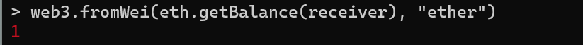

然后查询发送账户已经发出的交易数量：

```javascript
eth.getTransactionCount(sender)
```

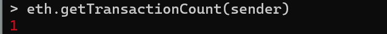

如果这是开发账户的第一笔交易，结果通常是 `1`。

## 章节自测

先不看答案，试着用自己的话解释每一题；再对照参考答案，检查自己是否分清了账户、交易、回执、Gas 与 Nonce。

### 题目

1. 为什么收款账户 B 不解锁也能收到 ETH？
2. 创建账户 B 后，区块高度为什么不会因此增加？
3. 为什么发送 1 ETH 要写 `value: web3.toWei(1, "ether")`？
4. 拿到 `txHash`，能证明转账成功了吗？
5. 为什么第一笔交易的 `nonce` 是 `0`，交易后 `eth.getTransactionCount(sender)` 却是 `1`？
6. `gas` 和 `gasUsed` 有什么区别？
7. `eth.getBlock("latest", true)` 中的 `true` 是什么意思？
8. 为什么要保存自己交易的 `txHash`，不能照抄教程截图里的？

### 参考答案

1. 接收 ETH 不需要 B 签名。A 发起转账时，由 A 使用自己的私钥签署交易；B 的地址只需作为收款地址写进交易。

   如果以后要**从 B 发出交易**，才需要使用 B 的私钥签名。在本章的实验中，B 的私钥加密保存在 Keystore 文件里，解锁账户是让 Geth 使用它签名的一种方式。

2. `geth account new` 主要是在本地生成密钥，并把加密后的私钥保存为 Keystore 文件。**创建账户本身不是链上交易**，所以这一步不会因为“新建了 B”而产生区块。

   账户地址可以先存在于你的本地文件中；等有人向这个地址转账，相关交易才会进入链上记录。

3. 交易对象的 `value` 使用 **Wei** 作为单位。1 ETH 等于 10¹⁸ Wei，因此 `web3.toWei(1, "ether")` 是把人容易理解的“1 ETH”转换成交易需要的数值。

   如果直接写 `value: 1`，发送的就是 **1 Wei**，也就是 10⁻¹⁸ ETH，远远不是 1 ETH。

4. 不能。`txHash` 是这笔交易的标识，可以用它查交易，但仅凭哈希不能判断交易是否已经执行成功。

   用 `eth.getTransactionReceipt(txHash)` 查询**交易回执**，查看 `status`：在本章的场景中，`status: 1` 表示执行成功。还可以查询 B 的余额，确认它是否收到了预期的 1 ETH：

   ```javascript
   web3.fromWei(eth.getBalance(receiver), "ether")
   ```

   这里 `getBalance(...)` 要用**圆括号**传入地址；`fromWei` 则把查询到的 Wei 换算成 ETH，方便阅读。

5. `nonce` 是发送账户的交易序号，从 **0** 开始。A 的第一笔交易使用 `nonce = 0`。这笔交易完成后，A 已发出的交易数量是 **1**，因此查询结果为 `1`；下一笔交易通常会使用 `nonce = 1`。

   可以把它理解成：**第一笔的编号是 0，但做完第一笔后，已完成的笔数是 1。**

6. 交易对象中的 `gas` 是这笔交易**最多允许使用多少 Gas**；交易回执中的 `gasUsed` 是它**实际使用了多少 Gas**。

   例如，一次向普通账户发送 ETH 的转账通常消耗 21,000 Gas。即使设置的 `gas` 上限高于 21,000，也不表示交易一定会把上限全部用完。

7. `"latest"` 指查询最新区块。第二个参数控制区块的 `transactions` 数组如何显示：

   - `true`：返回完整的交易对象，可以直接查看交易字段。
   - `false`：通常只返回交易哈希。

   它改变的是**交易列表的显示内容**，不是说 `false` 就无法查询区块信息。

8. 教程截图展示的是作者实验环境中的交易，你的本地开发链有自己的链上记录。即使操作步骤相同，两边的交易也不是同一笔；拿截图中的哈希查询你的本地链，通常查不到你刚发的交易。

   因此，执行 `eth.sendTransaction(...)` 后，要保存**自己控制台返回的 `txHash`**，后续查询交易对象、回执和所在区块时都使用它。

---

上一章：[第 1 章 运行本地 Geth 开发节点](01-running-a-local-geth-dev-chain.md) · 下一章：[第 3 章 理解交易生命周期与 Nonce](03-understanding-transaction-lifecycle-and-nonce.md)
