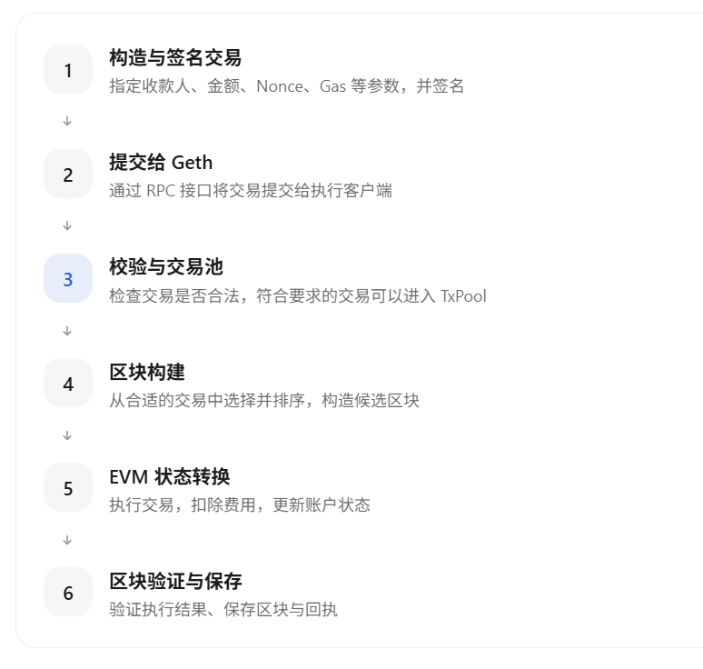
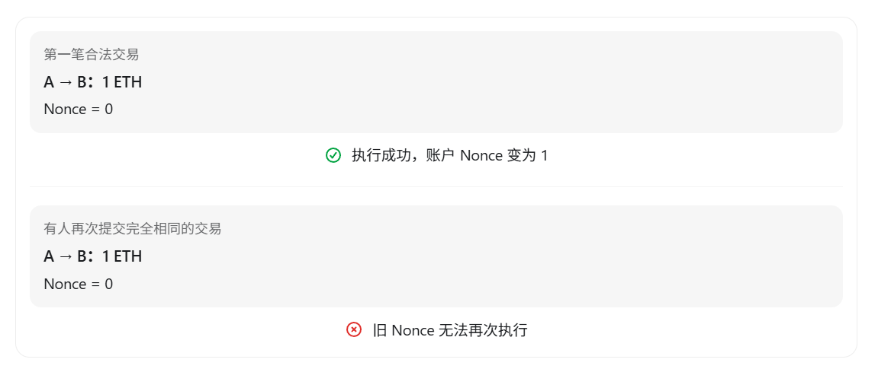
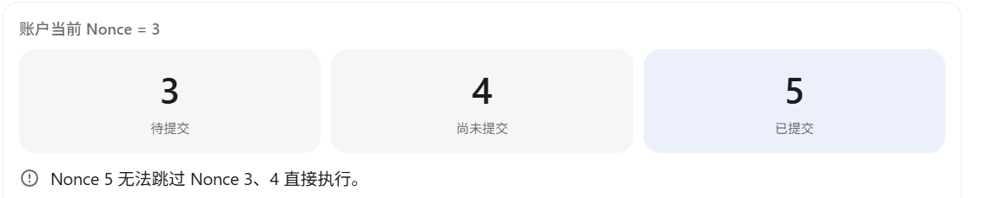
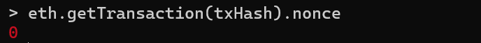
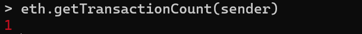

# 第 3 章 理解交易生命周期与 Nonce

本章承接[第 2 章](02-sending-the-first-eth-transaction.md)已经完成的转账实验，继续使用其中的 `sender` 和 `txHash` 观察交易与账户 Nonce。

当你向 Geth 提交一笔交易时，它不会立即变成已经执行的链上状态。以账户 A 向账户 B 发送 1 ETH 为例，一笔交易通常会经历以下逻辑阶段：



这个图描述的是逻辑流程，不代表进入 TxPool 的交易已经执行。真实 PoS 主网的区块构建、提议和验证还需要共识层参与；当前使用的 `--dev` 链会在本地模拟必要的出块过程。

## Nonce 为什么是必需的

假设账户 A 中有 10 ETH，并准备依次发送三笔交易：

| 交易 | 金额 | Nonce |
| --- | --- | --- |
| 交易 A | 1 ETH | 0 |
| 交易 B | 2 ETH | 1 |
| 交易 C | 3 ETH | 2 |

可以把 Nonce 理解为账户交易的递增序号，但它不是简单的交易 ID，也不是随机数。

对于普通外部账户（EOA），Nonce 表示该账户已经执行过多少笔会增加 Nonce 的交易。假设 Geth 当前记录账户 A 的 Nonce 为 `3`，那么这个账户下一笔正常执行的交易应当使用 Nonce `3`。

## 防止重复执行

Nonce 的一个重要作用是约束同一账户的交易顺序，并防止已执行交易被再次执行。



假设账户 A 已经成功执行一笔 Nonce 为 `0` 的转账。如果完全相同的交易被重复提交，节点可能在交易池校验阶段拒绝它；即使它被放入候选区块，也不能作为该账户下一笔有效交易再次执行。

需要区分两个概念：

1. Nonce 约束同一账户的交易顺序，并防止交易被重复执行。
2. Chain ID 与交易签名机制结合，用来防止交易被简单地跨链重放。

## Nonce 如何影响交易顺序

假设账户当前的 Nonce 为 `3`，但你先提交了 Nonce 为 `5` 的交易：



有些节点会暂时保留这种 Nonce 存在缺口的交易，等待前面的交易到来。节点是否接纳、保留多久，以及将其放在哪个交易池分组中，取决于客户端的交易池规则和配置。

## 动手验证 Nonce

继续使用前面已经发送成功的交易。在 Geth 控制台中查看这笔交易使用的 Nonce：

> 这里的 `txHash` 是第 2 章中**你自己发送交易**时得到的值。如果重新连接过控制台，请先用保存的交易哈希恢复这个变量，不要照抄教程截图里的哈希。

```javascript
eth.getTransaction(txHash).nonce
```



如果这是预置开发账户发送的第一笔交易，并且此前没有其他交易，你应该看到 `0`。这表示该交易使用了 Nonce `0`。

接着查询当前账户的 Nonce：

```javascript
eth.getTransactionCount(sender)
```



如果这笔交易已经执行成功，并且没有其他交易，你应该看到 `1`。

注意两个结果的区别：

- 交易的 Nonce 是 `0`。
- 账户当前的 Nonce 是 `1`。

这意味着账户下一笔正常交易应当使用 Nonce `1`。

## 章节自测

### 题目

1. 交易进入 TxPool，是否说明它已经执行、收款账户余额已经变化？
2. 账户当前 Nonce 为 `3`，先提交 Nonce 为 `5` 的交易，它能直接执行吗？
3. Nonce 为 `0` 的交易已经执行，为什么原样再提交一次不能再转一次钱？
4. Nonce 和 Chain ID 分别防止什么样的重复使用？
5. 为什么交易的 Nonce 是 `0`，账户当前的 Nonce 却是 `1`？
6. 交易进入 TxPool 后被丢弃，账户在链上的 Nonce 会增加吗？
7. 交易进入区块，但执行时 `revert`，Nonce 会增加吗？
8. 为什么本地 `--dev` 链的流程不能直接等同于真实 PoS 主网？

### 参考答案

1. **答案：不能。** TxPool 是节点暂时存放待处理交易的地方。交易进入 TxPool，说明节点接纳了它，准备等待后续处理；它还没有因此改变链上的余额或 Nonce。

   只有交易进入区块并经过执行，才能判断它对链上状态产生了什么结果。而且“进入区块”也不等于“转账成功”：如果执行失败，收款账户仍不会收到钱。要确认结果，可以查询交易回执和余额。

2. **答案：不能跳过前面的 Nonce。** 这个账户下一笔正常执行的交易应使用 Nonce `3`。Nonce 为 `5` 的交易要等 `3` 和 `4` 对应的交易先执行，才能轮到它。

   节点可能暂时保留这笔存在缺口的交易，具体是否保留取决于交易池规则。提高交易费用可能帮助某笔交易更快被打包，但**不能代替缺失的 Nonce `4`**。

3. **答案：** 第一笔交易执行后，发送账户的 Nonce 从 `0` 变为 `1`。原交易写着 Nonce `0`，已经不符合这个账户下一笔交易所需的 Nonce，所以不能在同一条链上再次执行。

   这也是 Nonce 的重要作用：约束同一账户的交易顺序，防止已经执行的交易被重复执行。

4. **答案：**

   - **Nonce** 约束同一账户在一条链上的交易顺序，防止已执行的交易在这条链上再次执行。
   - **Chain ID** 参与交易签名，用来防止一笔签名交易被简单地拿到 **Chain ID 不同的另一条链**上重放。

   可以简单记为：Nonce 主要处理“这个账户下一笔该轮到谁”；Chain ID 帮助确定“这笔签名交易是为哪条链准备的”。

5. **答案：** `eth.getTransaction(txHash).nonce` 查的是**这笔交易当时使用的序号**。如果它是账户的第一笔交易，结果就是 `0`。

   `eth.getTransactionCount(sender)` 查的是**发送账户当前的交易计数**。第一笔交易执行后，计数变成 `1`。在本章没有其他待处理交易的实验条件下，`1` 也是下一笔交易应使用的 Nonce。

   这和“第一个编号是 0，完成一个后总数是 1”是同一个道理。

6. **答案：不会。** 交易提交给节点，并不代表它已经在链上执行。如果它只待在 TxPool，后来又被丢弃，链上的账户状态没有因这笔交易改变，Nonce 也不会因它增加。

   这里最关键的区别是：**提交或暂存交易**与**交易进入区块执行**是两个阶段。

7. **答案：会。** 这笔交易已经进入区块并尝试执行，因此会占用发送账户的 Nonce，也会消耗 Gas。

   但它**没有执行成功**：`revert` 会撤销这次执行中的状态修改。例如转账或合约操作失败后，不能说收款人已经收到钱。查询回执时，`status` 通常为 `0`。这与“交易还在 TxPool 就被丢弃”不同：后者根本没有进入区块执行。

8. **答案：** 本章的 `--dev` 链是为了方便实验，在本地模拟必要的出块过程。你可以用它观察提交交易、执行交易和 Nonce 变化。

   真实 PoS 主网还需要**共识层**参与：协调验证者提议区块、验证区块，并逐步确认区块。执行层则负责交易执行和状态变化。因此，本地实验能帮助理解交易的关键阶段，但不能代表主网完整的出块与共识流程。

---

上一章：[第 2 章 发送第一笔 ETH 交易](02-sending-the-first-eth-transaction.md) · 下一章：[第 4 章 交易验证与 TxPool](04-transaction-validation-and-txpool.md)
