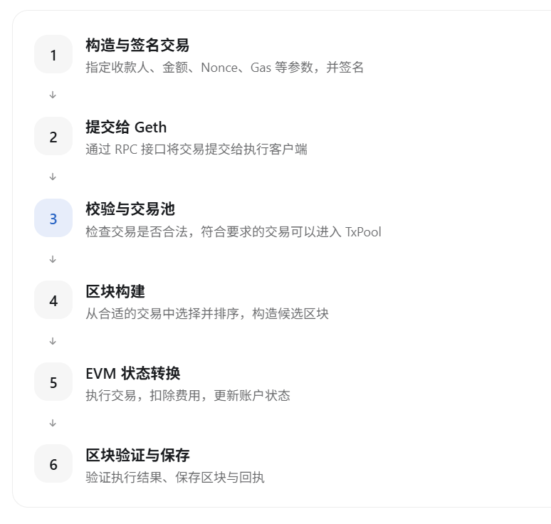
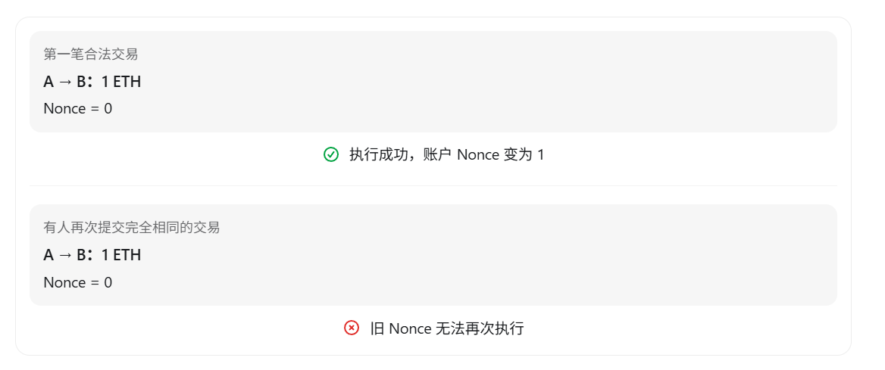
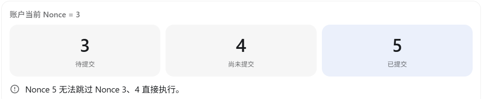
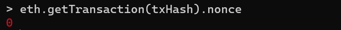
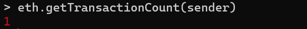

# 第 3 章 理解交易生命周期与 Nonce

本章承接[第 2 章](02-sending-the-first-eth-transaction.md)已经完成的转账实验，继续使用其中的 `sender` 和 `txHash` 观察交易与账户 Nonce。

当你向 Geth 提交一笔交易时，它不会立即变成已经执行的链上状态。以账户 A 向账户 B 发送 1 ETH 为例，一笔交易通常会经历以下逻辑阶段：



这个图描述的是逻辑流程，不代表进入 TxPool 的交易已经执行。真实 PoS 主网的区块构建、提议和验证还需要共识层参与；当前使用的 `--dev` 链会在本地模拟必要的出块过程。

## Nonce 为什么是必需的

假设账户 A 中有 10 ETH，并准备依次发送三笔交易：

| 交易 | 金额 | Nonce |
| --- | --- | --- |
| 交易 A | 1 ETH | 0 |
| 交易 B | 2 ETH | 1 |
| 交易 C | 3 ETH | 2 |

可以把 Nonce 理解为账户交易的递增序号，但它不是简单的交易 ID，也不是随机数。

对于普通外部账户（EOA），Nonce 表示该账户已经执行过多少笔会增加 Nonce 的交易。假设 Geth 当前记录账户 A 的 Nonce 为 `3`，那么这个账户下一笔正常执行的交易应当使用 Nonce `3`。

## 防止重复执行

Nonce 的一个重要作用是约束同一账户的交易顺序，并防止已执行交易被再次执行。



假设账户 A 已经成功执行一笔 Nonce 为 `0` 的转账。如果完全相同的交易被重复提交，节点可能在交易池校验阶段拒绝它；即使它被放入候选区块，也不能作为该账户下一笔有效交易再次执行。

需要区分两个概念：

1. Nonce 约束同一账户的交易顺序，并防止交易被重复执行。
2. Chain ID 与交易签名机制结合，用来防止交易被简单地跨链重放。

## Nonce 如何影响交易顺序

假设账户当前的 Nonce 为 `3`，但你先提交了 Nonce 为 `5` 的交易：



有些节点会暂时保留这种 Nonce 存在缺口的交易，等待前面的交易到来。节点是否接纳、保留多久，以及将其放在哪个交易池分组中，取决于客户端的交易池规则和配置。

## 动手验证 Nonce

继续使用前面已经发送成功的交易。在 Geth 控制台中查看这笔交易使用的 Nonce：

```javascript
eth.getTransaction(txHash).nonce
```



如果这是预置开发账户发送的第一笔交易，并且此前没有其他交易，你应该看到 `0`。这表示该交易使用了 Nonce `0`。

接着查询当前账户的 Nonce：

```javascript
eth.getTransactionCount(sender)
```



如果这笔交易已经执行成功，并且没有其他交易，你应该看到 `1`。

注意两个结果的区别：

- 交易的 Nonce 是 `0`。
- 账户当前的 Nonce 是 `1`。

这意味着账户下一笔正常交易应当使用 Nonce `1`。

---

上一章：[第 2 章 发送第一笔 ETH 交易](02-sending-the-first-eth-transaction.md) · 下一章：[第 4 章 交易验证与 TxPool](04-transaction-validation-and-txpool.md)
