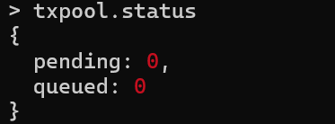
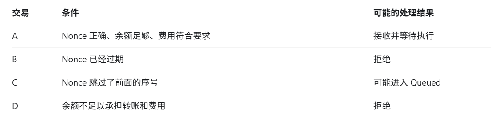
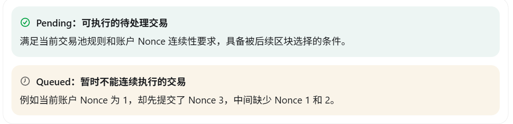
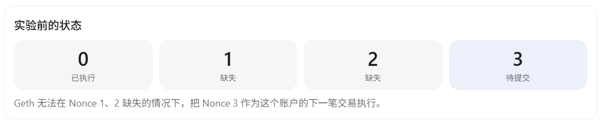
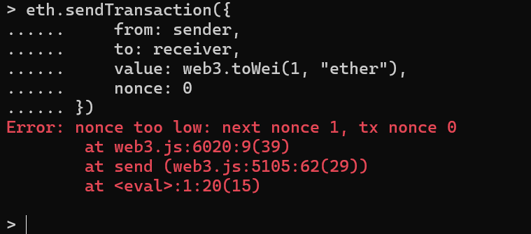
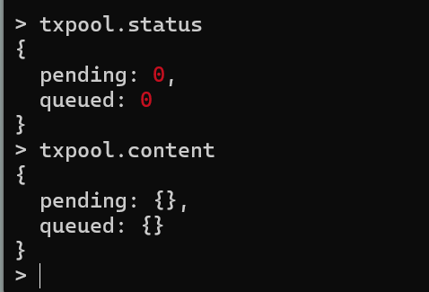
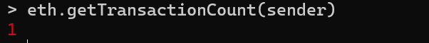
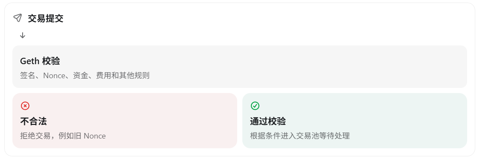

# 第 4 章 交易验证与 TxPool

本章承接[第 2 章](02-sending-the-first-eth-transaction.md)和[第 3 章](03-understanding-transaction-lifecycle-and-nonce.md)的实验状态。此时 `sender` 已经成功发送一笔交易，账户当前 Nonce 为 `1`。

## 查看交易池状态

执行：

```javascript
txpool.status
```



根据 [Geth 官方 txpool 文档](https://geth.ethereum.org/docs/interacting-with-geth/rpc/ns-txpool)，返回值包含两个计数：

- `pending`：目前可供后续区块考虑的待处理交易数量。
- `queued`：暂时无法连续执行、等待未来处理的交易数量。

如果两者都是 `0`，不代表刚才的交易没有经过 TxPool。因为当前使用的是 `--dev.period 0`，Geth 可能已经迅速将交易包含进区块，所以查询时交易池已经为空。


Geth 收到一笔交易后，会先检查它是否满足进入交易池的条件。不同交易可能得到不同的处理结果：



## Geth 不会无条件接收交易

Geth 接收交易时会进行多种检查，包括交易编码和类型、大小、签名、Nonce、费用参数，以及发送方是否有足够资金等。

需要注意：通过交易池验证不代表 EVM 执行一定成功。例如，一笔调用智能合约的交易可能通过交易池检查，却在实际执行时因为合约 `revert` 而失败。

## Pending 与 Queued 的区别



- **Pending**：满足当前交易池规则和账户 Nonce 连续性要求，具备被后续区块选择的条件。
- **Queued**：暂时不能连续执行，例如交易的 Nonce 与账户当前 Nonce 之间存在缺口。

这是经典交易池模型的解释。现代 Geth 对不同交易类型还可能使用专门的池和处理策略，因此不能认为所有交易都完全遵循同一套排队规则。

`txpool.status` 用于查看 Pending 和 Queued 的数量，`txpool.content` 则用于查看池中交易的具体内容。

## 思考一个 Nonce 缺口

当前发送账户的 Nonce 为 `1`，正常情况下下一笔交易应当使用 Nonce `1`。如果故意提交一笔 Nonce 为 `3` 的交易，中间就缺少 Nonce `1` 和 `2`：



本次先观察这个概念，不向原来的开发链实际提交这笔带缺口的交易。因为本地链使用 `--dev.period 0`，交易池行为可能受到自动出块机制影响。后续专门研究 TxPool 时，可以使用独立实验环境，避免留下干扰正常学习的排队交易。

## 实验 拒绝旧 Nonce 交易

当前账户的 Nonce 为 `1`。这次故意提交一笔 Nonce 为 `0` 的交易：

```javascript
eth.sendTransaction({
  from: sender,
  to: receiver,
  value: web3.toWei(1, "ether"),
  nonce: 0
})
```



Nonce `0` 已经被使用，因此 Geth 返回 `nonce too low` 并拒绝这笔交易。

这个实验说明：即使发送账户拥有足够的 ETH，Geth 也不会仅凭余额充足就接受交易。交易还必须符合账户状态和协议规则。

## 再次查看交易池

执行：

```javascript
txpool.status
txpool.content
```



两个命令的用途不同：

- `txpool.status`：显示 Pending 和 Queued 的数量。
- `txpool.content`：显示交易池中的具体交易，包括发送地址、Nonce 和交易哈希等信息。

如果没有其他待处理交易，两个分类仍然为空。被节点直接拒绝的旧 Nonce 交易不会成为待处理交易。

最后再次查询账户的 Nonce：

```javascript
eth.getTransactionCount(sender)
```



因为刚才的交易没有被执行，账户 Nonce 仍然是 `1`。

## 本节结论



交易提交给 Geth 后，节点会检查签名、Nonce、资金、费用和其他规则。不合法的交易会被拒绝；通过校验的交易才会根据当前条件进入交易池等待后续处理。

## 章节自测

### 题目

1. `txpool.status` 显示 `pending` 和 `queued` 都是 `0`，能证明刚才的交易没经过 TxPool 吗？
2. `pending` 与 `queued` 有什么区别？账户当前 Nonce 是 `1`，Nonce 为 `3` 的交易为什么不能直接执行？
3. 账户当前 Nonce 是 `1`，为什么余额充足时，Nonce 为 `0` 的交易仍会被拒绝？它会进入 TxPool 吗？
4. 交易通过交易池校验，就一定能执行成功吗？
5. 除了余额，Geth 接收交易时还会检查什么？
6. `txpool.status` 和 `txpool.content` 分别有什么用？
7. Nonce 为 `0` 的交易被拒绝后，交易池和账户 Nonce 应是什么状态？

### 参考答案

1. **答案：不能。** `txpool.status` 只显示**查询那一刻**交易池里还有多少笔交易，不能告诉你过去有没有交易进入过。

   本章使用 `--dev.period 0`，Geth 可能很快把交易打包进区块。等你查询时，交易已经离开 TxPool，因此两个数字都是 `0`。要判断刚才那笔交易的结果，应使用自己的 `txHash` 查询交易和回执。

2. **答案：** `pending` 中的交易满足当前交易池规则和 Nonce 连续性要求，**具备被后续区块选择的条件**；它们还没有执行。`queued` 中的交易暂时不能连续执行，Nonce 存在缺口是常见原因。

   账户当前 Nonce 为 `1`，需要先执行 Nonce 为 `1`、`2` 的交易，才能轮到 `3`。节点**可能**暂存 Nonce 为 `3` 的交易，但是否接纳、如何存放取决于交易池规则，不能保证它一定进入 `queued`。

3. **答案：** 当前 Nonce 为 `1`，说明账户已经用过 Nonce `0`。新交易再使用 `0`，不符合账户当前状态，所以 Geth 返回 `nonce too low`。

   **余额充足只是接收交易的条件之一。** 这笔旧 Nonce 交易在入池前就被拒绝，不会成为 TxPool 中的待处理交易，也不会让账户 Nonce 增加。

4. **答案：不能。** 交易池校验主要判断交易能否被节点接收，例如格式、签名、Nonce、费用和资金是否符合要求。它不会保证将来执行合约代码时一定成功。

   例如，一笔合约调用可以通过入池检查，进入区块后却在 EVM 执行时触发 `revert`。这时交易已经被打包，但**执行失败**，回执中的 `status` 通常为 `0`。所以“进入 TxPool”“进入区块”和“执行成功”是不同的判断。

5. **答案：** 本章提到的检查包括交易的**编码和类型、大小、签名、Nonce、费用参数**，以及发送方资金是否足够。

   例如，账户有足够的 ETH，但交易使用了过低的旧 Nonce，仍会被拒绝；签名无效或费用参数不符合规则，也可能无法入池。你回答的 Gas 和 Chain ID 也有关：Gas 上限及费用参数需要符合规则，Chain ID 则与交易签名的有效性有关。

6. **答案：**

   - `txpool.status` 看**数量**：当前有多少笔 `pending` 和 `queued` 交易。
   - `txpool.content` 看**内容**：池中具体有哪些交易，可以查看发送地址、Nonce、交易哈希等信息。

   因此，如果只想知道池里有没有待处理交易，先看 `status`；如果想检查某笔交易的具体信息，就看 `content`。

7. **答案：** 如果没有其他待处理交易，`txpool.status` 应显示 `pending = 0`、`queued = 0`；`eth.getTransactionCount(sender)` 应返回 `1`。

   原因是这笔交易因 `nonce too low` **在入池前就被拒绝**：它没有留在交易池，也没有进入区块执行。发送账户之前的 Nonce 是 `1`，拒绝之后仍是 `1`。

---

上一章：[第 3 章 理解交易生命周期与 Nonce](03-understanding-transaction-lifecycle-and-nonce.md) · 下一章：[第 5 章 理解 Gas 与 EIP-1559 交易费用](05-understanding-gas-and-eip-1559-fees.md)
