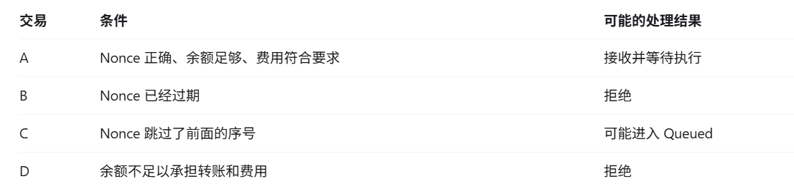
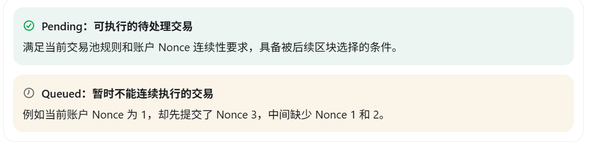
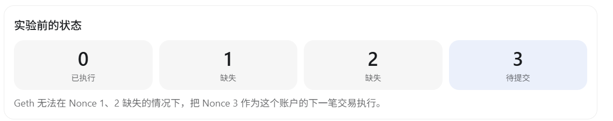
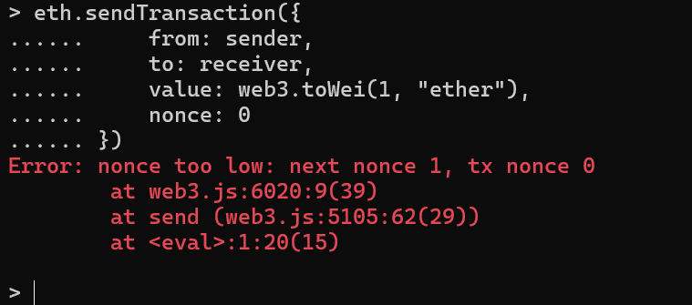
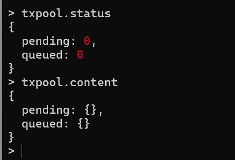
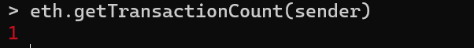
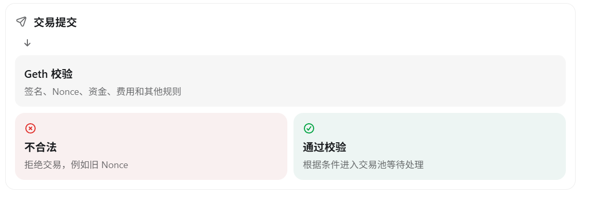

# 第 4 章 交易验证与 TxPool

本章承接[第 2 章](02-sending-the-first-eth-transaction.md)和[第 3 章](03-understanding-transaction-lifecycle-and-nonce.md)的实验状态。此时 `sender` 已经成功发送一笔交易，账户当前 Nonce 为 `1`。

## 查看交易池状态

执行：

```javascript
txpool.status
```


根据 [Geth 官方 txpool 文档](https://geth.ethereum.org/docs/interacting-with-geth/rpc/ns-txpool)，返回值包含两个计数：

- `pending`：目前可供后续区块考虑的待处理交易数量。
- `queued`：暂时无法连续执行、等待未来处理的交易数量。

如果两者都是 `0`，不代表刚才的交易没有经过 TxPool。因为当前使用的是 `--dev.period 0`，Geth 可能已经迅速将交易包含进区块，所以查询时交易池已经为空。


Geth 收到一笔交易后，会先检查它是否满足进入交易池的条件。不同交易可能得到不同的处理结果：



## Geth 不会无条件接收交易

Geth 接收交易时会进行多种检查，包括交易编码和类型、大小、签名、Nonce、费用参数，以及发送方是否有足够资金等。

需要注意：通过交易池验证不代表 EVM 执行一定成功。例如，一笔调用智能合约的交易可能通过交易池检查，却在实际执行时因为合约 `revert` 而失败。

## Pending 与 Queued 的区别



- **Pending**：满足当前交易池规则和账户 Nonce 连续性要求，具备被后续区块选择的条件。
- **Queued**：暂时不能连续执行，例如交易的 Nonce 与账户当前 Nonce 之间存在缺口。

这是经典交易池模型的解释。现代 Geth 对不同交易类型还可能使用专门的池和处理策略，因此不能认为所有交易都完全遵循同一套排队规则。

`txpool.status` 用于查看 Pending 和 Queued 的数量，`txpool.content` 则用于查看池中交易的具体内容。

## 思考一个 Nonce 缺口

当前发送账户的 Nonce 为 `1`，正常情况下下一笔交易应当使用 Nonce `1`。如果故意提交一笔 Nonce 为 `3` 的交易，中间就缺少 Nonce `1` 和 `2`：



本次先观察这个概念，不向原来的开发链实际提交这笔带缺口的交易。因为本地链使用 `--dev.period 0`，交易池行为可能受到自动出块机制影响。后续专门研究 TxPool 时，可以使用独立实验环境，避免留下干扰正常学习的排队交易。

## 实验 拒绝旧 Nonce 交易

当前账户的 Nonce 为 `1`。这次故意提交一笔 Nonce 为 `0` 的交易：

```javascript
eth.sendTransaction({
  from: sender,
  to: receiver,
  value: web3.toWei(1, "ether"),
  nonce: 0
})
```



Nonce `0` 已经被使用，因此 Geth 返回 `nonce too low` 并拒绝这笔交易。

这个实验说明：即使发送账户拥有足够的 ETH，Geth 也不会仅凭余额充足就接受交易。交易还必须符合账户状态和协议规则。

## 再次查看交易池

执行：

```javascript
txpool.status
txpool.content
```



两个命令的用途不同：

- `txpool.status`：显示 Pending 和 Queued 的数量。
- `txpool.content`：显示交易池中的具体交易，包括发送地址、Nonce 和交易哈希等信息。

如果没有其他待处理交易，两个分类仍然为空。被节点直接拒绝的旧 Nonce 交易不会成为待处理交易。

最后再次查询账户的 Nonce：

```javascript
eth.getTransactionCount(sender)
```



因为刚才的交易没有被执行，账户 Nonce 仍然是 `1`。

## 本节结论



交易提交给 Geth 后，节点会检查签名、Nonce、资金、费用和其他规则。不合法的交易会被拒绝；通过校验的交易才会根据当前条件进入交易池等待后续处理。
