# 第 5 章 理解 Gas 与 EIP-1559 交易费用

本章承接[第 2 章](02-sending-the-first-eth-transaction.md)已经完成的转账实验，继续使用其中的交易和回执理解 Gas、实际手续费以及 EIP-1559 费用结构。

## Gas 与 Gas Price

首先要区分两个概念：

| 概念 | 含义 |
| --- | --- |
| Gas | 衡量以太坊执行交易所消耗的计算资源 |
| Gas Price | 执行每单位 Gas 需要支付的 ETH 数量 |

两者不是同一个东西。可以把 Gas 理解为计算资源的计量单位，把 Gas Price 理解为每单位资源的价格。

以太坊执行交易需要消耗网络计算资源。引入 Gas，一方面用于计算交易费用，另一方面可以限制一笔交易能够消耗的资源，避免无限计算。

## 计算交易手续费

一笔交易的实际手续费可以表示为：


假设一笔普通 ETH 转账实际消耗 `21,000` Gas，每单位 Gas 的实际价格为 `2` Gwei，那么手续费为：

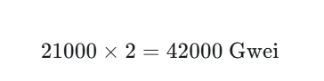

也就是 `0.000042 ETH`。

根据[以太坊 Gas 官方文档](https://ethereum.org/developers/docs/gas/)，Gas Price 通常使用 Gwei 表示，`1 Gwei = 10^-9 ETH`。

## Gas Limit 与 Gas Used

这是初学者最容易混淆的一组概念。假设你准备执行一笔普通 ETH 转账，并为交易设置：

```javascript
gas: 50000
```


这表示最多允许这笔交易消耗 `50,000` Gas，并不代表实际一定会消耗 `50,000` Gas。如果交易最终只消耗 `21,000` Gas，剩余的 Gas 额度不会作为已消耗 Gas 收费。

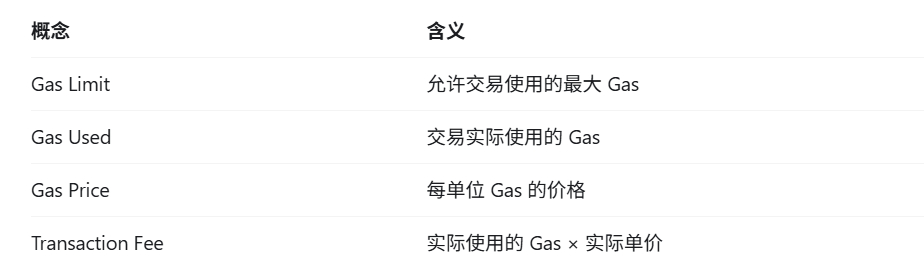

| 概念 | 含义 |
| --- | --- |
| Gas Limit | 允许交易使用的最大 Gas |
| Gas Used | 交易实际消耗的 Gas |
| Gas Price | 每单位 Gas 的实际价格 |
| Transaction Fee | `Gas Used × Effective Gas Price` |

之前查询创世区块时出现了 `gasLimit: 11500000` 和 `gasUsed: 0`。这里要注意：区块的 Gas Limit 和单笔交易的 Gas Limit 是两个不同层次的限制。创世区块的 `gasUsed` 为 `0`，是因为当时没有执行普通交易。

## EIP-1559 费用结构

现在常见的 EIP-1559 动态费用交易，会将每单位 Gas 的实际费用拆分为两部分：

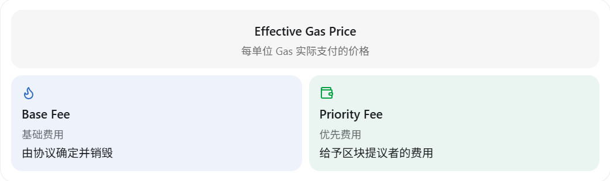

- **Base Fee**：由协议根据区块使用情况确定，并在交易执行后销毁。
- **Priority Fee**：实际支付给区块提议者的优先费用，也常被称为小费。

例如 Base Fee 是 `10` Gwei，实际 Priority Fee 是 `2` Gwei，那么实际 Gas Price 是 `12` Gwei。

EIP-1559 交易还可以设置两个上限：

| 字段 | 含义 |
| --- | --- |
| `maxFeePerGas` | 每单位 Gas 愿意支付的最高总价 |
| `maxPriorityFeePerGas` | 每单位 Gas 愿意支付的最高优先费用 |

对于普通 EIP-1559 动态费用交易，每单位 Gas 的实际价格可以表示为：

```text
effectiveGasPrice = min(maxFeePerGas, baseFeePerGas + maxPriorityFeePerGas)
```

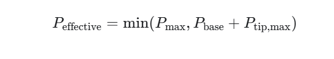

`maxFeePerGas` 是价格上限，不是一定会支付的价格。只要上限足够覆盖 Base Fee 和实际 Priority Fee，最终就按实际价格收费。

基础费用会销毁，实际优先费用会归区块提议者。这套机制由 [EIP-1559](https://eips.ethereum.org/EIPS/eip-1559) 引入，并不是以太坊转向 PoS 时才出现的。

## 验证一笔交易的实际费用

继续使用前面实验中的交易。如果已经关闭并重新打开过控制台，需要先恢复 `txHash`。下面是本次实验使用的交易哈希；如果你重新运行过开发链，应替换为自己的交易哈希：

```javascript
var txHash = "0xa48e27a28cc2e0521785219a51c0a733f4d9375bbf4244f615c64f7d6c37bfe0"
```

### 实验 1 查询交易消耗的 Gas

执行：

```javascript
eth.getTransactionReceipt(txHash)
```

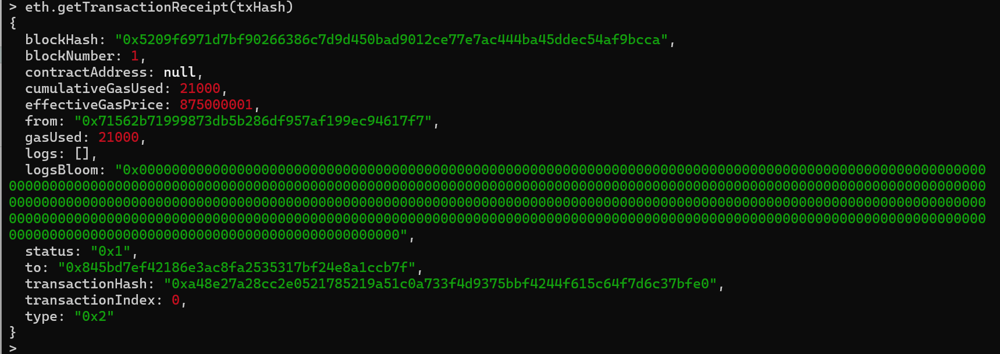

重点观察三个字段：

- `gasUsed`：交易实际消耗的 Gas。
- `effectiveGasPrice`：交易实际支付的每单位 Gas 价格。
- `status`：`0x1` 表示执行成功，`0x0` 表示执行失败。

本次简单 ETH 转账消耗了 `21,000` Gas。具体结果应以自己的交易回执为准。

### 实验 2 计算实际手续费

在控制台中保存交易回执，并使用实际消耗量和实际 Gas Price 计算费用：

```javascript
var receipt = eth.getTransactionReceipt(txHash)
var fee = receipt.gasUsed * receipt.effectiveGasPrice
web3.fromWei(fee, "ether")
```

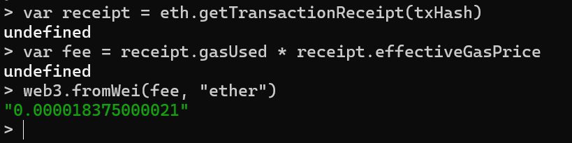

本次结果为 `0.000018375000021 ETH`。

这里的 `fee` 是普通 JavaScript 数值计算，适合当前数值仍处于安全整数范围内的小额实验。在正式应用中，Wei 金额应使用 BigInt 或任意精度整数库，避免 JavaScript 数值精度问题。

### 实验 3 查看交易费用参数

执行：

```javascript
eth.getTransaction(txHash)
```

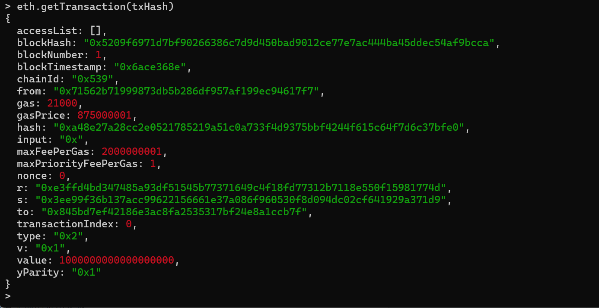

重点观察：

- `gas`：交易允许使用的最大 Gas。
- `gasPrice`：Geth 返回的这笔交易实际每单位 Gas 价格。
- `maxFeePerGas`：每单位 Gas 的最高总价。
- `maxPriorityFeePerGas`：每单位 Gas 的最高优先费用。
- `type`：交易类型。

`type: 0x2` 表示 EIP-1559 动态费用交易，旧式 Legacy 交易的类型通常是 `0x0`。

结合交易对象和交易回执，可以得到本次实验的关键结果：

| 字段 | 结果 | 意义 |
| --- | ---: | --- |
| `type` | `0x2` | EIP-1559 动态费用交易 |
| `nonce` | `0` | 发送账户的第一笔交易 |
| `gas` | `21000` | 交易 Gas 上限 |
| `gasUsed` | `21000` | 实际消耗的 Gas |
| `status` | `0x1` | 交易执行成功 |
| `value` | `10^18 Wei` | 转账 1 ETH |
| `blockNumber` | `1` | 进入创世区块后的第一个区块 |
| `chainId` | `0x539` | 十进制为 1337，本地开发链标识 |

其中 `gasUsed` 和 `status` 来自交易回执，其余字段来自交易对象。

### 实验 4 查看区块的 Base Fee

先取得交易对象，再查询交易所在区块的 `baseFeePerGas`：

```javascript
var tx = eth.getTransaction(txHash)
eth.getBlock(tx.blockNumber).baseFeePerGas
```

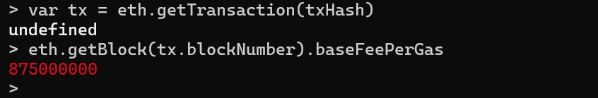

这样观察到的是交易实际进入区块时的 Base Fee，而不是当前最新区块的费用。

## 分析 EIP-1559 费用去向

本次交易设置了：

```text
maxFeePerGas: 2000000001
maxPriorityFeePerGas: 1
```

分别表示：

- 每单位 Gas 最高总价为 `2.000000001` Gwei。
- 每单位 Gas 最高优先费用为 `1` Wei。

交易所在区块和回执显示：

```text
baseFeePerGas: 875000000
effectiveGasPrice: 875000001
```

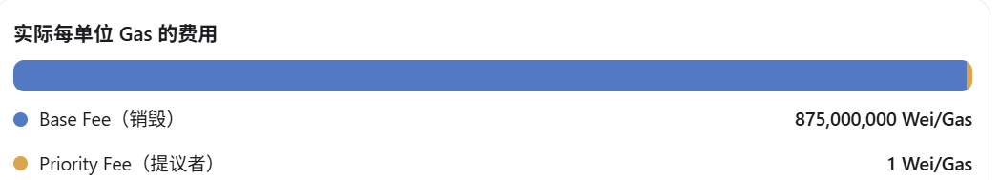

为什么最终只支付 `875,000,001 Wei/Gas`，而不是允许的最高 `2,000,000,001 Wei/Gas`？

因为 `maxFeePerGas` 是价格上限，不是必然支付的价格。本次交易的实际价格为：

```text
min(2000000001, 875000000 + 1) = 875000001 Wei/Gas
```

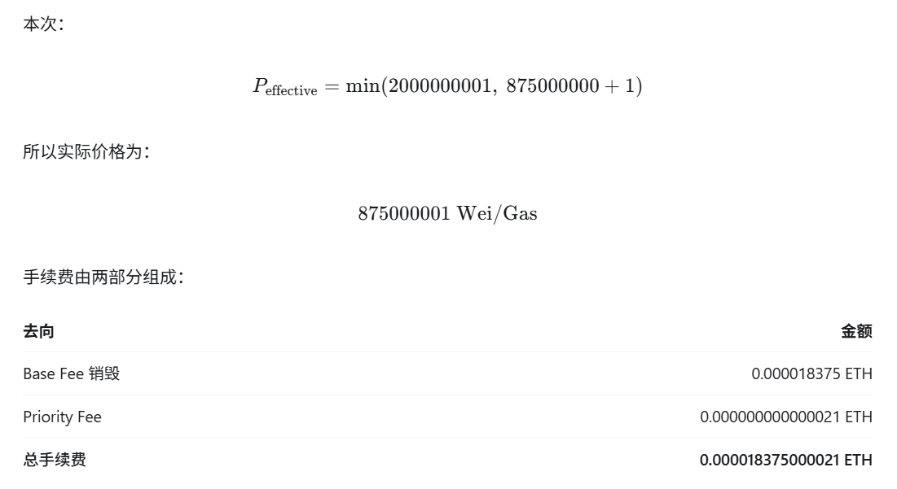

乘以本次实际使用的 `21,000` Gas 后：

| 去向 | 金额 |
| --- | ---: |
| Base Fee 销毁 | `0.000018375 ETH` |
| Priority Fee 归区块提议者 | `0.000000000000021 ETH` |
| 总手续费 | `0.000018375000021 ETH` |

## 为什么 Base Fee 下降了 12.5%

对比创世区块和交易所在区块：

```text
// Block 0
baseFeePerGas: 1000000000

// Block 1
baseFeePerGas: 875000000
```

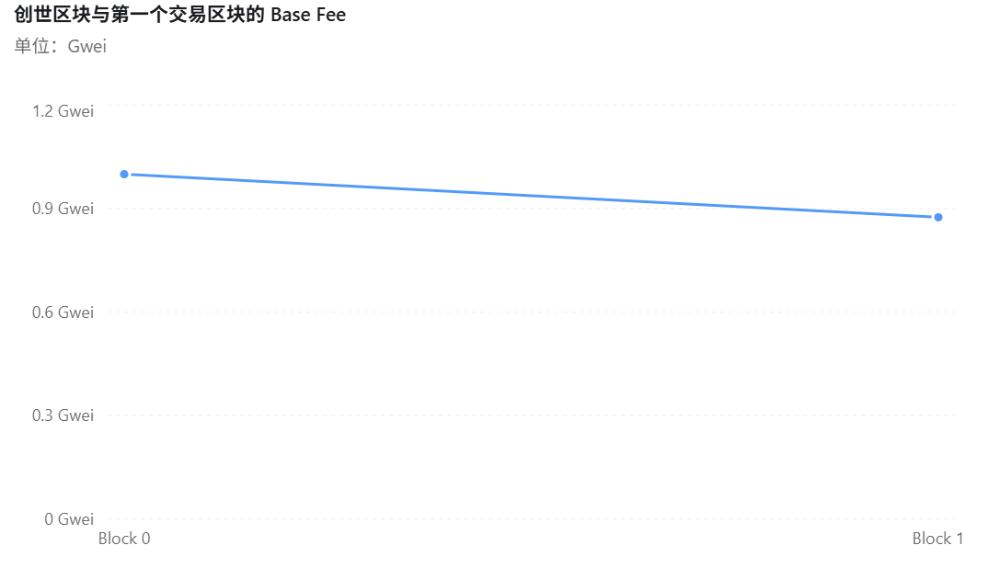

Base Fee 从 `1` Gwei 降至 `0.875` Gwei，下降了 `12.5%`。

EIP-1559 会比较上一个区块的 Gas Used 和目标 Gas 使用量，并据此调整下一个区块的 Base Fee。根据[以太坊 Gas 官方文档](https://ethereum.org/developers/docs/gas/)，单个区块的 Base Fee 最多上调或下调 `12.5%`。

在这次本地开发链实验中，创世区块的 `gasUsed` 为 `0`，远低于目标使用量，因此下一个区块的 Base Fee 按最大幅度下降。这说明 Base Fee 不是用户随意设置的固定价格，而是由协议规则根据前一个区块的使用情况调整。

---

上一章：[第 4 章 交易验证与 TxPool](04-transaction-validation-and-txpool.md) · 下一章：[第 6 章 以太坊状态机与账户状态转换](06-ethereum-state-machine-and-account-transitions.md)
