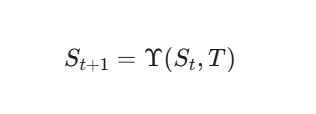
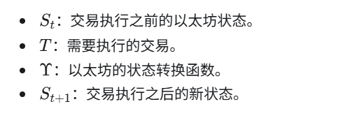
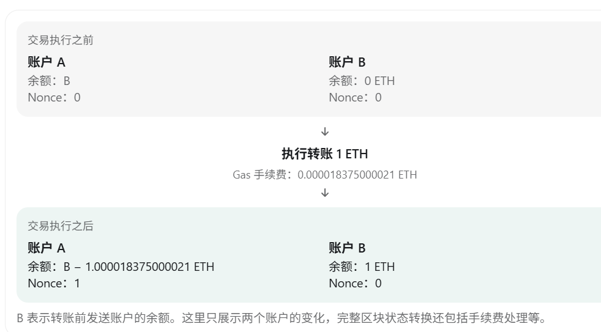
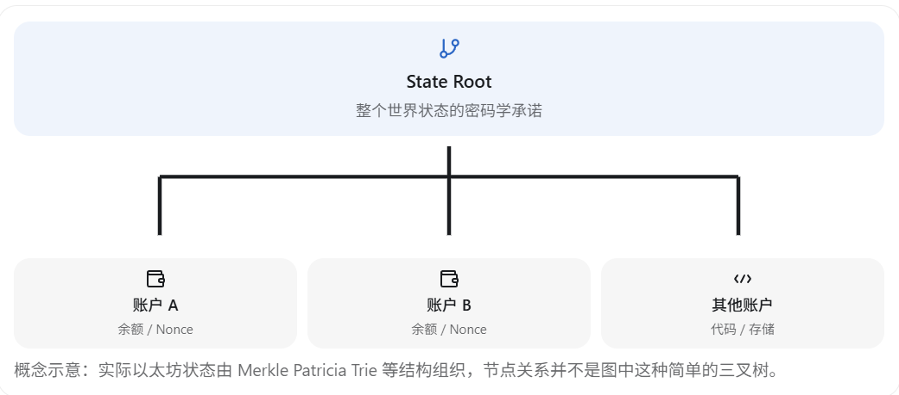
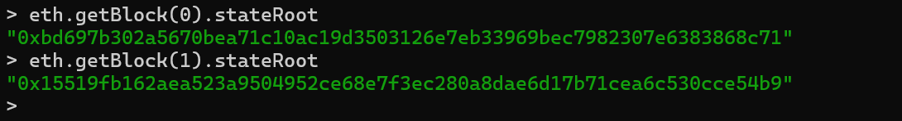
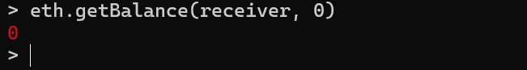
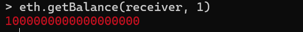
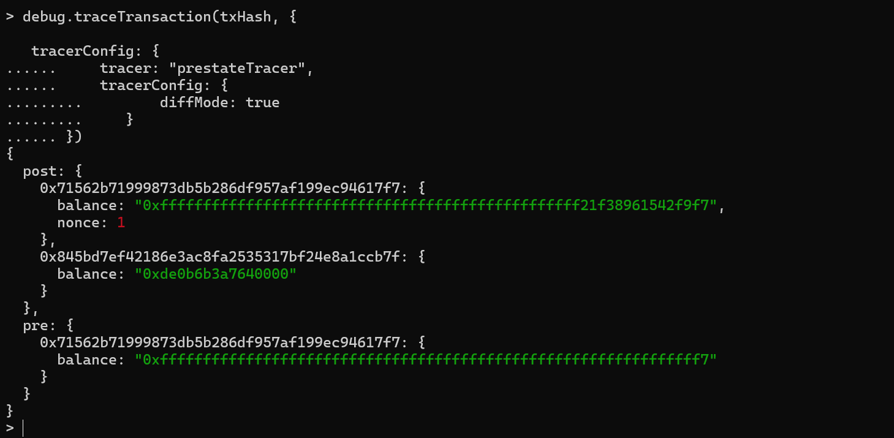

# 第 6 章 以太坊状态机与账户状态转换

前面几章已经完成了一笔真实的 ETH 转账，并观察了 Nonce、交易池和 Gas。本章继续向执行层内部深入：一笔交易被执行时，以太坊究竟改变了什么，以及如何用 Geth 验证这些变化。

## 从旧状态计算新状态

以太坊可以理解为一个由交易驱动的状态机。给定旧状态和一笔有效交易，执行层按照协议规则计算出新的状态。



公式中的各部分分别表示：

- `S_t`：交易执行前的以太坊状态。
- `T`：需要执行的交易。
- `Υ`：以太坊的状态转换函数。
- `S_{t+1}`：交易执行后的新状态。

用更直观的方式表达，就是：



[以太坊 EVM 官方文档](https://ethereum.org/developers/docs/evm/)也使用状态转换函数描述这一过程：有效旧状态和有效交易经过确定的执行规则后，会得到新的有效状态。

## 用 ETH 转账理解状态转换

继续使用前面的转账实验。发送账户向接收账户转入 `1 ETH` 后，至少会发生以下变化：

- 发送账户的余额减少，减少量包括转账金额和交易手续费。
- 发送账户的 Nonce 从 `0` 增加到 `1`。
- 接收账户的余额增加 `1 ETH`。



因此，交易的作用不只是向区块中加入一条记录。执行交易会按照协议规则改变以太坊的世界状态，区块则保存能够验证这次执行结果的数据。

## 以太坊账户保存什么

以太坊有两类账户：

1. **外部拥有账户（EOA）**：由私钥控制，可以主动发起交易。前面实验中的 `sender` 和 `receiver` 都是 EOA。
2. **合约账户（Contract Account）**：由部署在链上的代码控制，可以持有 ETH，并拥有自己的代码和存储空间。

在以太坊的账户状态表示中，一个账户包含四个主要字段：

| 字段 | 作用 |
| --- | --- |
| `nonce` | EOA 已发送的交易数量，或合约账户创建合约的计数 |
| `balance` | 账户持有的余额，单位为 Wei |
| `storageRoot` | 账户存储树的根哈希；EOA 的存储为空 |
| `codeHash` | 账户 EVM 字节码的哈希；EOA 没有合约代码 |

这些字段的定义可以在[以太坊账户官方文档](https://ethereum.org/developers/docs/accounts/)中找到。账户私钥不属于链上账户状态，它由钱包或本地 Keystore 管理。

在 Geth 控制台中执行：

```javascript
eth.getBalance(sender)
```

本质上是在请求节点读取指定区块状态中的账户余额。未传入区块参数时，查询的是最新状态。

## State Root 是什么

查询创世区块时，可以看到类似下面的字段：

```text
stateRoot: "0xbd697b302a5670bea71c10ac19d3503126e7eb33969bec7982307e6383868c71"
```

> 这串哈希只是作者本地创世区块的示例。比较时请以**你自己的节点**返回的 `eth.getBlock(0).stateRoot` 为准，不必与示例相同。

`stateRoot` 是区块执行完成后全局状态树的根哈希。它把账户余额、Nonce、合约代码和存储等状态组织成可验证的数据结构，并在区块中保存一个紧凑的根值。



[以太坊区块官方文档](https://ethereum.org/developers/docs/blocks/)说明，执行区块中的交易会更新全局状态，执行后的状态必须与区块记录的 `state_root` 一致。

如果账户余额、Nonce、代码或存储发生变化，状态树的内容也会变化，通常会产生不同的 State Root。但 State Root 只是对整个状态的密码学承诺，不能仅凭这个哈希直接读取账户余额；读取或验证具体状态仍需要相应的状态数据和证明。

## 实验一 比较交易前后的 State Root

如果重新打开过 Geth 控制台，先定义前面实验使用的交易哈希。下面的是作者实验的示例，**请替换为第 2 章中你实际得到的 `txHash`**；如果重新初始化了开发链，则需先在新链上重新发送交易：

```javascript
var txHash = "0xa48e27a28cc2e0521785219a51c0a733f4d9375bbf4244f615c64f7d6c37bfe0"
```

查看交易所在区块及其前一个区块的 State Root。本次实验中交易进入 Block 1，因此前一个区块正好是创世区块：

> 下面的 Block 1 是本次实验中转账所在的区块。如果你的交易进入了其他区块，请用 `eth.getTransaction(txHash).blockNumber` 查看实际高度，把第二次查询改为该高度、第一次查询改为该高度减一。

```javascript
eth.getBlock(0).stateRoot
eth.getBlock(1).stateRoot
```



在本次实验中，两个结果不同，说明 Block 0 的状态和 Block 1 执行交易后的状态不同。需要注意，State Root 不是只根据转账金额计算的哈希，而是整个区块执行结束后的世界状态根。

## 实验二 查询历史账户余额

不带第二个参数时，`eth.getBalance(receiver)` 查询最新状态。传入区块高度后，可以查询账户在指定区块状态下的余额。

先定义实验地址：

> 下面两个地址是作者本地链的示例。请改用第 2 章实际使用的发送、接收地址；也可以通过 `eth.getTransaction(txHash).from` 和 `.to` 核对。

```javascript
var sender = "0x71562b71999873db5b286df957af199ec94617f7"
var receiver = "0x845bd7ef42186e3ac8fa2535317bf24e8a1ccb7f"
```

> 下文的 Block 0、Block 1 和余额是本次转账实验的结果。如果你的转账位于其他区块，请改为查询该交易所在区块及其前一个区块，并以自己节点返回的余额为准。

查询 Block 0 结束时的接收账户余额：

```javascript
eth.getBalance(receiver, 0)
```



再查询 Block 1 结束时的余额：

```javascript
eth.getBalance(receiver, 1)
```



实验结果如下：

| 查询状态 | 接收账户余额 |
| --- | ---: |
| Block 0 | `0 Wei` |
| Block 1 | `1,000,000,000,000,000,000 Wei` |

同一个账户在不同区块高度可以拥有不同的状态。[以太坊 JSON-RPC 官方文档](https://ethereum.org/developers/docs/apis/json-rpc/#eth_getbalance)规定，`eth_getBalance` 的第二个参数用于指定要查询的区块状态。

历史状态查询还取决于节点保留了多少状态数据。如果较旧的查询返回状态不可用，并不表示区块消失，而可能是节点已经裁剪了相应历史状态。Geth 的[归档模式文档](https://geth.ethereum.org/docs/fundamentals/archive)介绍了完整保留或按范围保留历史状态的配置。

## 实验三 追踪真正的状态转换

`eth.getTransaction(txHash)` 返回交易本身的信息。如果希望观察交易改变了哪些账户字段，可以使用 Geth 的调试接口：

```javascript
debug.traceTransaction(txHash, {
  tracer: "prestateTracer",
  tracerConfig: {
    diffMode: true
  }
})
```

这个调用会按原来的执行环境重新执行并追踪已存在的交易，不会再次提交交易。`prestateTracer` 的差异模式会返回类似下面的结构：



主要字段的含义如下：

| 字段 | 含义 |
| --- | --- |
| `pre` | 交易开始执行时的相关账户状态 |
| `post` | 交易执行完成后的相关账户状态 |
| `balance` | 账户余额，使用十六进制 Wei 表示 |
| `nonce` | 账户交易计数 |

根据 [Geth 内置追踪器文档](https://geth.ethereum.org/docs/developers/evm-tracing/built-in-tracers#prestatetracer)，差异模式只列出被修改的账户。因此，输出重点是交易实际触及和改变的状态，而不是整个世界状态。

在本次结果中，可以观察到：

- 发送账户余额减少，Nonce 增加到 `1`。
- 接收账户余额增加 `1 ETH`。
- 手续费也反映在发送账户的余额变化中。

这就把“提交一笔交易”和“改变账户状态”连接了起来。

## 为什么普通转账没有合约字节码

前面查询交易时看到：

```text
input: "0x"
```

这是向普通 EOA 发送 ETH 的交易。接收账户没有合约代码，交易也没有携带调用数据，因此不会执行接收方合约中的 EVM 字节码。

不过，这笔交易仍然属于执行层的状态转换：节点需要验证交易、扣除手续费、更新余额和 Nonce，并计算新的 State Root。以后部署并调用 Solidity 智能合约时，追踪结果中才会出现 `PUSH`、`SSTORE`、`CALL` 等具体 EVM 操作码。

## 本章结论

以太坊执行层把旧状态和有效交易转换成新状态。账户字段描述具体状态，State Root 对区块执行结束后的全局状态作出密码学承诺，而 Geth 的历史查询和 `prestateTracer` 可以帮助我们直接验证状态如何变化。

---

上一章：[第 5 章 理解 Gas 与 EIP-1559 交易费用](05-understanding-gas-and-eip-1559-fees.md)

下一章：[第 7 章 EVM 与智能合约执行](07-evm-and-smart-contract-execution.md)
