# 第 7 章 EVM 与智能合约执行

上一章通过普通 ETH 转账观察了账户余额、Nonce 和 State Root 的变化。本章把接收方从普通外部账户（EOA）换成合约账户：先部署一个最小的 `Storage` 合约，再调用它修改持久化状态，最后用 Geth 追踪真正执行的 `SSTORE` 操作码。

## 从普通转账到合约执行

向 EOA 转账时，交易主要引起余额、Nonce 和手续费相关的状态变化；当交易的目标是合约账户时，执行客户端还会加载并执行该账户的合约字节码。


[Ethereum.org 的 EVM 文档](https://ethereum.org/developers/docs/evm/)把 EVM 描述为以太坊节点一致执行合约代码的虚拟环境。它不是一个独立操作系统，而是以太坊协议定义的受限执行环境；Geth 等执行客户端各自实现这套规则。

EVM 是一台基于栈的虚拟机。Solidity 源代码经过编译后会变成 EVM 字节码，字节码由一系列操作码组成，例如：

| 操作码 | 作用 |
| --- | --- |
| `PUSH` | 把数据压入 EVM 栈 |
| `ADD` | 执行加法 |
| `SLOAD` | 从合约持久化存储读取数据 |
| `SSTORE` | 向合约持久化存储写入数据 |
| `CALL` | 调用另一个账户 |
| `RETURN` | 返回执行结果 |
| `REVERT` | 中止当前调用并回滚该调用上下文中的状态更改 |


这些操作码由 EVM 逐步执行，并按规则消耗 Gas。可以在 [Ethereum.org 的操作码参考](https://ethereum.org/developers/docs/evm/opcodes/)中查看各指令的栈输入、输出和基础语义。

## 编写第一个本地合约

本章使用一个经典的 `Storage` 合约。Geth 的[合约控制台教程](https://geth.ethereum.org/docs/interacting-with-geth/javascript-console-contracts)也采用了相近的示例。

```solidity
// SPDX-License-Identifier: MIT
pragma solidity ^0.8.20;

contract Storage {
    uint256 private number;

    function set(uint256 _number) public {
        number = _number;
    }

    function get() public view returns (uint256) {
        return number;
    }
}
```

这个合约只有一个状态变量 `number`。它没有被显式初始化，因此初始值为 `0`。

- `set(uint256 _number)` 会修改持久化状态，必须通过交易执行。
- `get()` 只读取当前数值，可以通过 `eth_call` 在本地模拟执行，不需要发送链上交易。

`private` 只是 Solidity 的访问控制修饰符，不代表数据被加密或对外保密。Solidity 的[安全注意事项](https://docs.soliditylang.org/en/latest/security-considerations.html#private-information-and-randomness)明确提醒，链上使用的数据即使标记为 `private`，仍然可以被外部观察。

在这个没有继承、复杂类型和自定义存储布局的简单合约中，第一个状态变量 `number` 位于 Slot 0。Solidity 的[存储布局文档](https://docs.soliditylang.org/en/latest/internals/layout_in_storage.html)说明，常规布局从第一个状态变量所在的 Slot 0 开始；复杂合约还需要考虑打包、继承、映射和动态数组等规则。


## 启动本地 Geth 并连接控制台

在 Ubuntu 中打开第一个终端，启动之前使用的本地开发链：

```bash
cd ~/ethereum/go-ethereum

./build/bin/geth --dev \
  --datadir ~/ethereum/dev-chain \
  --dev.period 0
```

`--dev` 启动带预充值开发账户的本地开发网络；`--dev.period 0` 表示仅在存在待处理交易时创建区块。这两个参数的当前定义可以在 [Geth 命令行选项](https://geth.ethereum.org/docs/fundamentals/command-line-options#developer-chain)中确认。

保持第一个终端运行，再打开第二个终端并通过 IPC 连接 JavaScript 控制台：

```bash
cd ~/ethereum/go-ethereum
./build/bin/geth attach ~/ethereum/dev-chain/geth.ipc
```

[Geth JavaScript 控制台文档](https://geth.ethereum.org/docs/interacting-with-geth/javascript-console)说明，`geth attach` 可以通过 IPC 连接一个正在运行的节点。

## 使用 Remix 编译 Solidity

打开官方的 [Remix IDE](https://remix.ethereum.org/)，创建 `Storage.sol`，粘贴前面的合约代码，然后点击 **Compile Storage.sol**。


编译成功后，在 **Compilation Details** 中展开 **BYTECODE**。Remix 会提供 ABI、部署字节码和已部署字节码等编译产物；这些产物也记录在 [Remix 编译产物文档](https://remix-ide.readthedocs.io/en/latest/contract_metadata.html)中。


部署时要复制 **Creation Bytecode**，而不是 **Deployed Bytecode**：

- Creation Bytecode 包含创建合约时要执行的初始化代码，并在结束时返回运行时代码。
- Deployed Bytecode 是部署完成后保存在合约地址上的运行时代码。

Geth 和 EVM 不会直接执行 Solidity 源代码；它们执行编译器生成的 EVM 字节码。

## 使用 Geth 部署合约

回到 Geth JavaScript 控制台，把刚才复制的 Creation Bytecode 保存到变量中：

```javascript
var bytecode = "0x这里替换成从Remix复制的CreationBytecode"
```

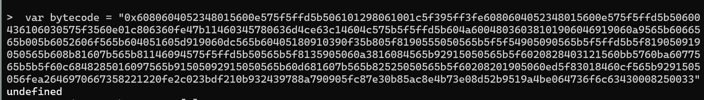

替换占位文字时要注意：

- 字节码必须以 `0x` 开头。
- 如果 Remix 复制出的内容已经包含 `0x`，不要重复添加。
- Creation Bytecode 很长，粘贴后可以先检查变量开头和末尾是否完整。

然后保存开发链的发送账户：

```javascript
var sender = eth.accounts[0]
```


发送合约创建交易：

```javascript
var deployTx = eth.sendTransaction({
  from: sender,
  data: bytecode,
  gas: 1000000
})
```

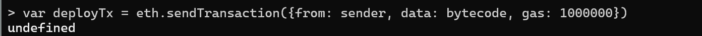

这笔交易没有 `to` 字段，因为它不是调用一个已有账户，而是在创建新合约。`gas: 1000000` 是允许这笔交易使用的 Gas 上限，并不表示最终一定会消耗这么多。

## 检查部署结果

查询部署交易的回执：

```javascript
var receipt = eth.getTransactionReceipt(deployTx)
```

如果交易尚未被包含进区块，结果可能暂时是 `null`。在当前 `--dev.period 0` 模式下，节点会在有待处理交易时创建区块；稍后重新执行查询即可。

获得回执后，检查执行状态和新合约地址：

```javascript
receipt.status
receipt.contractAddress
```

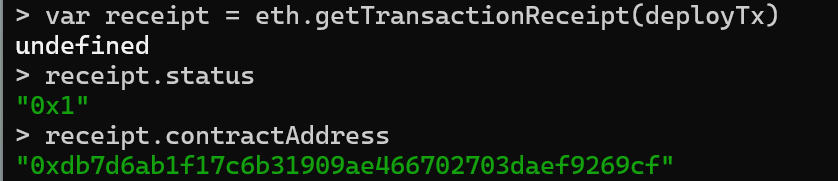

成功回执的 `status` 为 `"0x1"`。`contractAddress` 是这次创建出来的新合约地址。将它保存下来，供后续调用使用：

```javascript
var contractAddress = receipt.contractAddress
```

接着读取该地址上的代码：

```javascript
eth.getCode(contractAddress)
```

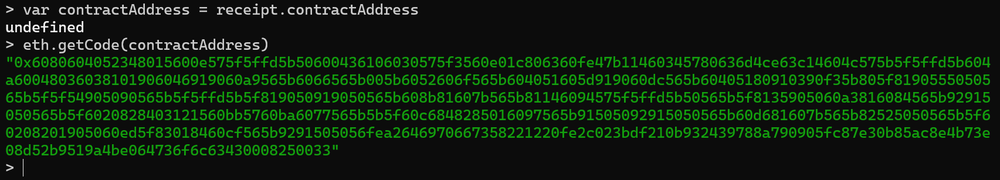

如果返回值不是空代码 `0x`，说明这个地址上已经保存了合约的运行时代码。[Ethereum JSON-RPC 文档](https://ethereum.org/developers/docs/apis/json-rpc/#eth_getcode)对 `eth_getCode` 的定义正是“返回指定地址上的代码”。

## 读取合约的初始存储

部署完成后，读取合约 Slot 0：

```javascript
eth.getStorageAt(contractAddress, 0)
```

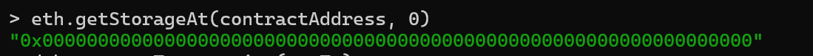

返回的 32 字节数据全部为零，说明 `number` 的初始值是 `0`。这里直接读取原始存储槽，是为了在下一步执行 `set(100)` 后进行前后对照。[Ethereum JSON-RPC 文档](https://ethereum.org/developers/docs/apis/json-rpc/#eth_getstorageat)说明，`eth_getStorageAt` 用地址和存储位置读取指定槽位的值。

## 构造 `set(100)` 的调用数据

调用合约函数时，交易的 `data` 字段要遵循 Solidity ABI 编码。对于 `set(100)`，可以在控制台中手动拼出调用数据：

```javascript
var callData = "0x60fe47b1" + "64".padStart(64, "0")
callData
```

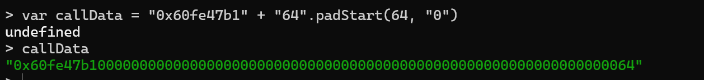

这串数据由两部分组成：

| 数据 | 意义 |
| --- | --- |
| `60fe47b1` | `set(uint256)` 的四字节函数选择器 |
| 后面的 64 个十六进制字符 | 参数 `100` 的 32 字节 ABI 编码 |

函数选择器是函数签名 `set(uint256)` 的 Keccak-256 哈希前四个字节。参数部分的末尾是 `64`，它是十六进制的 `100`；前面的零把这个 `uint256` 补齐为 32 字节。Solidity 的 [ABI 规范](https://docs.soliditylang.org/en/latest/abi-spec.html#function-selector)定义了函数选择器和参数编码规则。

## 调用合约并检查回执

将调用数据发送到已经部署的合约地址：

```javascript
var setTx = eth.sendTransaction({
  from: sender,
  to: contractAddress,
  data: callData,
  gas: 300000
})

setTx
```

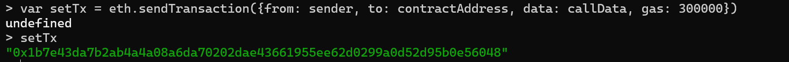

这里与合约创建交易的关键差别是出现了 `to: contractAddress`：这次交易调用的是一个已经存在的合约。成功提交后，`setTx` 保存交易哈希。

查询回执并检查执行状态：

```javascript
var setReceipt = eth.getTransactionReceipt(setTx)
setReceipt.status
```

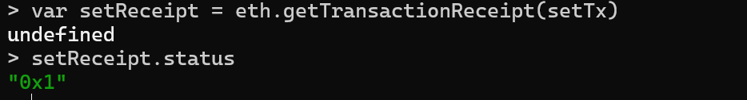

预期 `status` 为 `"0x1"`。如果回执暂时为 `null`，说明交易还没有进入区块，可以稍后重新查询。

再查看交易实际消耗的 Gas：

```javascript
setReceipt.gasUsed
```

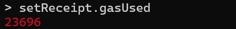

截图中的数值来自本次实验。实际值可能随 Solidity 编译器版本、优化设置和 EVM 规则变化，不应把它当成所有环境中的固定值。

## 验证 Slot 0 已经更新

再次读取合约 Slot 0：

```javascript
eth.getStorageAt(contractAddress, 0)
```

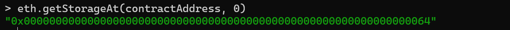

预期结果为：

```text
0x0000000000000000000000000000000000000000000000000000000000000064
```

末尾的 `64` 是十六进制的 `100`，说明持久化状态变量 `number` 已经从 `0` 变成 `100`。

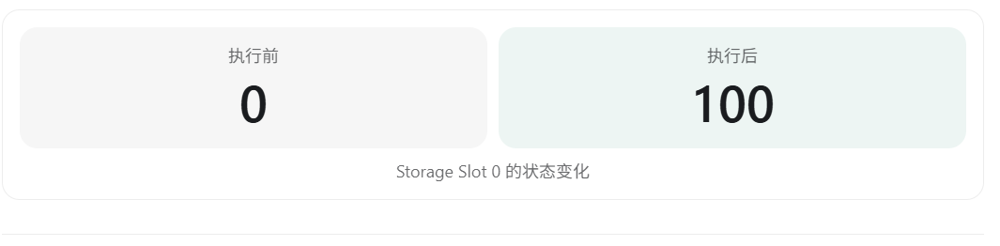

## 追踪真正执行的 `SSTORE`

`SSTORE` 是把数据写入当前合约持久化存储的 EVM 操作码。为了避免直接查看数百条指令，先把默认操作码追踪结果保存到变量，再只筛选 `SSTORE`：

```javascript
var trace = debug.traceTransaction(setTx)

trace.structLogs.filter(function(step) {
  return step.op === "SSTORE"
})
```

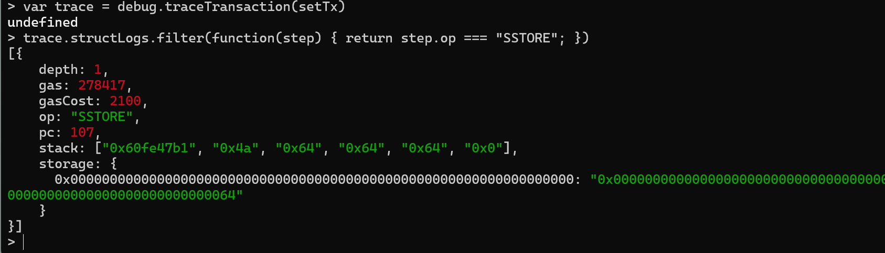

默认追踪结果的 `structLogs` 按执行顺序记录操作码步骤。[Geth 基础追踪文档](https://geth.ethereum.org/docs/developers/evm-tracing/basic-traces)介绍了这种结构化操作码日志；其中与本次实验最相关的字段是：

| 字段 | 含义 |
| --- | --- |
| `pc` | 当前指令在字节码中的程序计数器位置 |
| `op` | 当前执行的 EVM 操作码 |
| `gas` | 执行该步骤前剩余的 Gas |
| `gasCost` | 追踪器为该步骤记录的 Gas 成本 |
| `stack` | 执行该步骤前的 EVM 栈内容 |

具体的 `pc`、栈内容和 Gas 数值会受编译器与执行规则影响；本实验真正要验证的是：调用 `set(100)` 的执行轨迹中出现了 `SSTORE`，并且交易完成后 Slot 0 的值确实变成了 `100`。

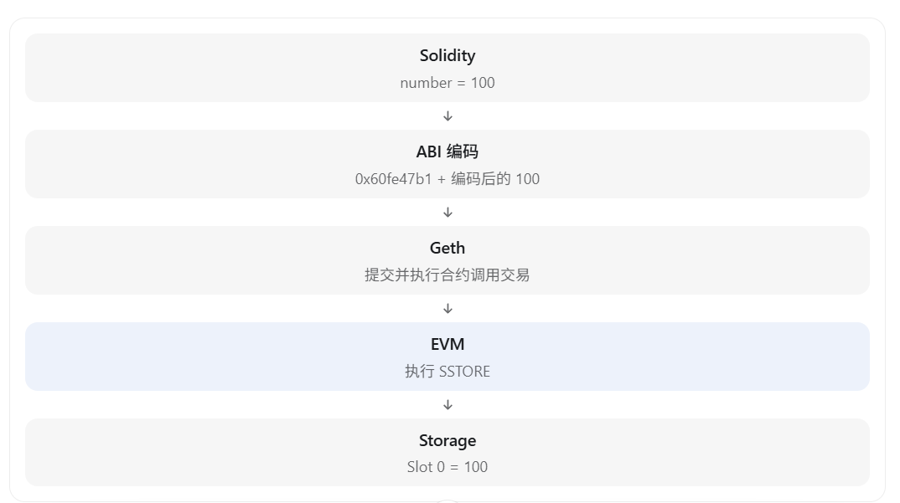

至此，完整链路已经贯通：

1. Solidity 编译器把 `Storage.sol` 变成 Creation Bytecode 和运行时代码。
2. Geth 接收合约创建交易，EVM 执行初始化代码并把运行时代码保存到新地址。
3. `set(100)` 被编码为函数选择器和 ABI 参数，通过交易发送给合约。
4. EVM 执行运行时代码，其中的 `SSTORE` 把 `100` 写入 Slot 0。
5. `eth.getStorageAt` 和 `debug.traceTransaction` 分别从状态与执行轨迹两个角度验证结果。

## 本章结论

EVM 是以太坊执行智能合约的确定性、基于栈的虚拟机。Solidity 只是更易编写的高级语言；真正被节点执行的是编译后的字节码。通过部署 `Storage`、手动构造 `set(100)` 的调用数据、读取 Slot 0 并筛选 `SSTORE`，我们第一次把源代码、ABI、交易、操作码和持久化状态变化连接成了一条可观察的执行链。
