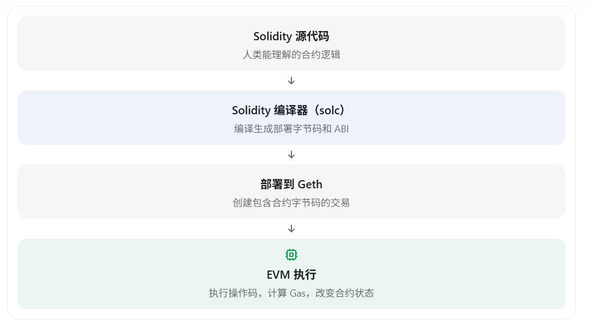
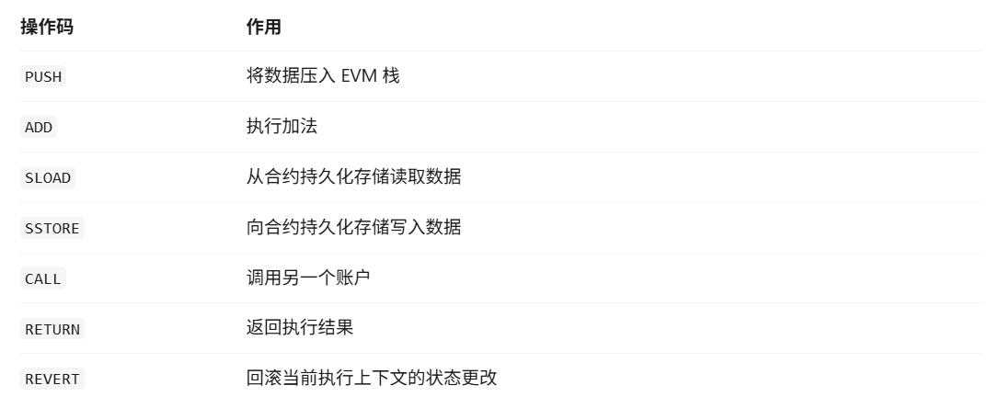
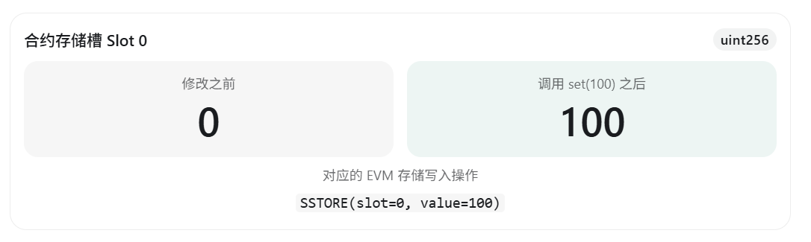
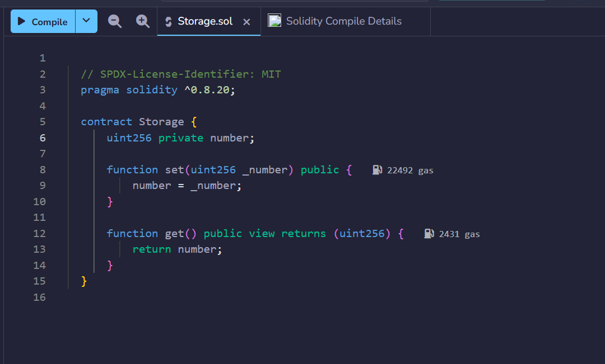
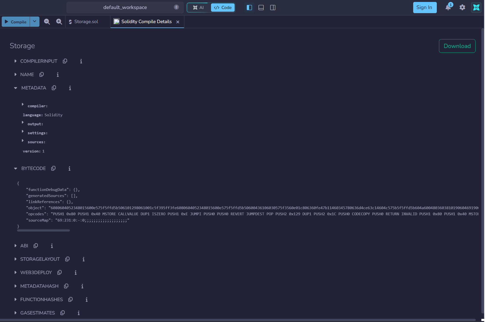

# 第 7 章 EVM 与智能合约执行

上一章通过普通 ETH 转账观察了账户余额、Nonce 和 State Root 的变化。本章把接收方从普通外部账户（EOA）换成合约账户：先部署一个最小的 `Storage` 合约，再调用它修改持久化状态，最后用 Geth 追踪真正执行的 `SSTORE` 操作码。

## 从普通转账到合约执行

向 EOA 转账时，交易主要引起余额、Nonce 和手续费相关的状态变化；当交易的目标是合约账户时，执行客户端还会加载并执行该账户的合约字节码。



[Ethereum.org 的 EVM 文档](https://ethereum.org/developers/docs/evm/)把 EVM 描述为以太坊节点一致执行合约代码的虚拟环境。它不是一个独立操作系统，而是以太坊协议定义的受限执行环境；Geth 等执行客户端各自实现这套规则。

EVM 是一台基于栈的虚拟机。Solidity 源代码经过编译后会变成 EVM 字节码，字节码由一系列操作码组成，例如：

| 操作码 | 作用 |
| --- | --- |
| `PUSH` | 把数据压入 EVM 栈 |
| `ADD` | 执行加法 |
| `SLOAD` | 从合约持久化存储读取数据 |
| `SSTORE` | 向合约持久化存储写入数据 |
| `CALL` | 调用另一个账户 |
| `RETURN` | 返回执行结果 |
| `REVERT` | 中止当前调用并回滚该调用上下文中的状态更改 |



这些操作码由 EVM 逐步执行，并按规则消耗 Gas。可以在 [Ethereum.org 的操作码参考](https://ethereum.org/developers/docs/evm/opcodes/)中查看各指令的栈输入、输出和基础语义。

## 编写第一个本地合约

本章使用一个经典的 `Storage` 合约。Geth 的[合约控制台教程](https://geth.ethereum.org/docs/interacting-with-geth/javascript-console-contracts)也采用了相近的示例。

```solidity
// SPDX-License-Identifier: MIT
pragma solidity ^0.8.20;

contract Storage {
    uint256 private number;

    function set(uint256 _number) public {
        number = _number;
    }

    function get() public view returns (uint256) {
        return number;
    }
}
```

这个合约只有一个状态变量 `number`。它没有被显式初始化，因此初始值为 `0`。

- `set(uint256 _number)` 会修改持久化状态，必须通过交易执行。
- `get()` 只读取当前数值，可以通过 `eth_call` 在本地模拟执行，不需要发送链上交易。

`private` 只是 Solidity 的访问控制修饰符，不代表数据被加密或对外保密。Solidity 的[安全注意事项](https://docs.soliditylang.org/en/latest/security-considerations.html#private-information-and-randomness)明确提醒，链上使用的数据即使标记为 `private`，仍然可以被外部观察。

在这个没有继承、复杂类型和自定义存储布局的简单合约中，第一个状态变量 `number` 位于 Slot 0。Solidity 的[存储布局文档](https://docs.soliditylang.org/en/latest/internals/layout_in_storage.html)说明，常规布局从第一个状态变量所在的 Slot 0 开始；复杂合约还需要考虑打包、继承、映射和动态数组等规则。



## 启动本地 Geth 并连接控制台

在 Ubuntu 中打开第一个终端，启动之前使用的本地开发链：

```bash
cd ~/ethereum/go-ethereum

./build/bin/geth --dev \
  --datadir ~/ethereum/dev-chain \
  --dev.period 0
```

`--dev` 启动带预充值开发账户的本地开发网络；`--dev.period 0` 表示仅在存在待处理交易时创建区块。这两个参数的当前定义可以在 [Geth 命令行选项](https://geth.ethereum.org/docs/fundamentals/command-line-options#developer-chain)中确认。

保持第一个终端运行，再打开第二个终端并通过 IPC 连接 JavaScript 控制台：

```bash
cd ~/ethereum/go-ethereum
./build/bin/geth attach ~/ethereum/dev-chain/geth.ipc
```

[Geth JavaScript 控制台文档](https://geth.ethereum.org/docs/interacting-with-geth/javascript-console)说明，`geth attach` 可以通过 IPC 连接一个正在运行的节点。

## 使用 Remix 编译 Solidity

打开官方的 [Remix IDE](https://remix.ethereum.org/)，创建 `Storage.sol`，粘贴前面的合约代码，然后点击 **Compile Storage.sol**。



编译成功后，在 **Compilation Details** 中展开 **BYTECODE**。Remix 会提供 ABI、部署字节码和已部署字节码等编译产物；这些产物也记录在 [Remix 编译产物文档](https://remix-ide.readthedocs.io/en/latest/contract_metadata.html)中。



部署时要复制 **Creation Bytecode**，而不是 **Deployed Bytecode**：

- Creation Bytecode 包含创建合约时要执行的初始化代码，并在结束时返回运行时代码。
- Deployed Bytecode 是部署完成后保存在合约地址上的运行时代码。

Geth 和 EVM 不会直接执行 Solidity 源代码；它们执行编译器生成的 EVM 字节码。
