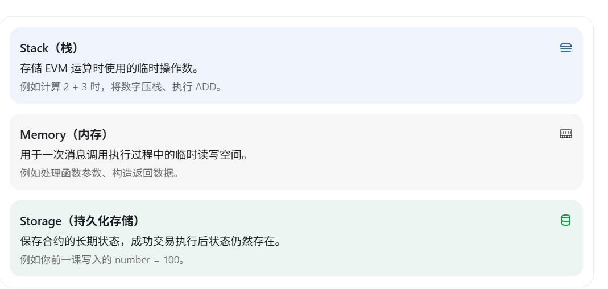
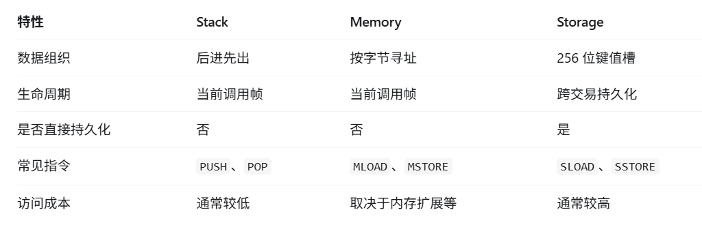
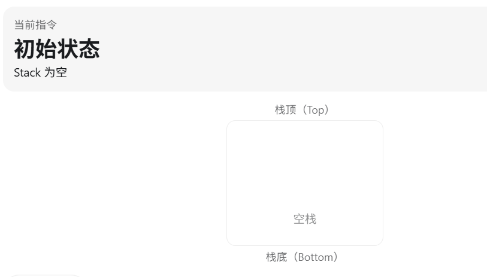
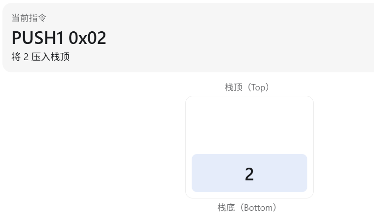
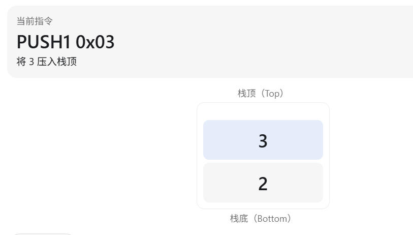
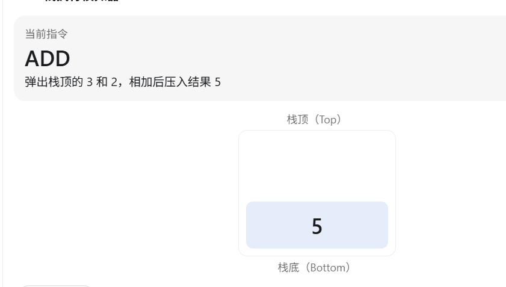
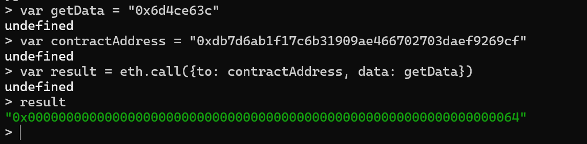
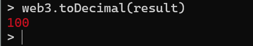
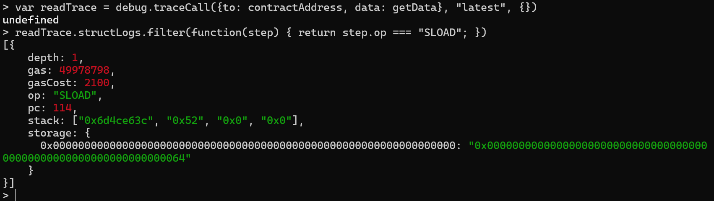

# 第 8 章 EVM 的 Stack、Memory 与 Storage

上一章部署了 `Storage` 合约，并用 `SSTORE` 把 `number` 从 `0` 改为 `100`。这一章沿用同一个合约：先弄清 EVM 在执行时把数据放在哪里，再追踪 `get()` 如何用 `SLOAD` 读出这个值。

## 为什么需要不同的数据空间？

EVM 执行操作码时，需要临时保存运算数、准备函数返回值，也需要保存交易结束后仍然存在的合约状态。这些用途对应不同的数据空间：Stack（栈）、Memory（内存）和 Storage（持久化存储）。





| 数据空间 | 主要用途 | 生命周期 | 常见操作码 |
| --- | --- | --- | --- |
| Stack | 保存操作码的运算数和中间结果 | 当前调用帧 | `PUSH1`、`POP`、`ADD` |
| Memory | 保存临时的字节数据，例如返回值 | 当前调用帧 | `MLOAD`、`MSTORE` |
| Storage | 保存合约账户的长期状态 | 成功的状态变更可以跨交易保留 | `SLOAD`、`SSTORE` |

这里说的“当前调用帧”是一次合约调用的执行上下文；内部调用会建立自己的调用帧。Memory 和 Stack 都不会因为本次调用成功，就变成合约的持久化状态。[Ethereum.org 的 EVM 文档](https://ethereum.org/developers/docs/evm/)也区分了执行期间的临时内存与账户状态中的 Storage。

## 用 Stack 计算 `2 + 3`

EVM 是基于栈的虚拟机。一个简单的加法可以写成三条操作码：

```text
PUSH1 0x02
PUSH1 0x03
ADD
```

从空栈开始：



`PUSH1 0x02` 把 `2` 压入栈顶：



`PUSH1 0x03` 再把 `3` 压入栈顶：



最后，`ADD` 取出两个栈顶元素，相加后把 `5` 压回栈顶：



栈遵循“后进先出”：最近压入的 `3` 最先被读取。EVM 栈最多容纳 1024 个元素，每个元素是 256 位的字；这些限制可在 [Ethereum.org 的 EVM 文档](https://ethereum.org/developers/docs/evm/#evm-instructions)中查到。

回想上一章 `SSTORE` 追踪中的栈片段：

```text
stack: ["0x60fe47b1", "0x4a", "0x64", "0x64", "0x64", "0x0"]
```

Geth 在默认操作码追踪中展示的是**执行该操作码之前**的栈。这里最后的 `0x0` 位于栈顶，是 `SSTORE` 要写入的 Storage Slot 编号；紧挨着它的 `0x64` 是写入值，也就是十进制的 `100`。前面的元素属于当时的执行上下文，不必把它们当作本次写入的参数。

## Memory 用来做什么？

Stack 适合操作码之间传递少量 256 位数据；要处理较长或按字节组织的临时数据，EVM 还提供 Memory。例如合约函数返回一个 `uint256` 时，编译出的字节码通常会先把返回值放进 Memory，再通过 `RETURN` 返回一段内存数据。

假设要把 `100` 写入 Memory 的偏移量 `0x80`，可以用：

```text
PUSH1 0x64
PUSH1 0x80
MSTORE
```

`MSTORE` 从栈顶取出偏移量 `0x80`，再取出值 `0x64`，从该偏移量起写入一个 256 位字（32 字节）。这是解释操作码的简化例子，不等同于前面 `Storage` 合约的完整编译结果。Memory 会在调用执行时按需扩展，其 Gas 成本与扩展量有关；调用结束后，这些内存数据不会写入合约账户的持久化状态。

## Storage 为什么不同？

上一章执行 `set(100)` 后，查询 Slot 0：

```javascript
eth.getStorageAt(contractAddress, 0)
```

得到的值是：

```text
0x0000000000000000000000000000000000000000000000000000000000000064
```

这就是合约账户的持久化状态：交易成功后，后续交易仍能读到它；正常保存并重新打开开发链数据库后，也可以继续读取。要注意，如果换了 `--datadir` 或重新部署合约，原来的地址和状态未必存在。

除了这三种空间，以太坊还提供通过 `TLOAD` 和 `TSTORE` 访问的 **Transient Storage（瞬态存储）**。它能在同一笔交易中供同一合约的内部调用共享，但交易结束后会被清除，不会成为账户的长期状态。这是另一种数据空间，不能把它与 Memory 或持久化 Storage 混为一谈；详见 [EIP-1153](https://eips.ethereum.org/EIPS/eip-1153)。

## 实验：追踪 `get()` 中的 `SLOAD`

这次不重新部署合约，也不发送新的链上交易。我们继续使用上一章已执行过 `set(100)` 的 `Storage` 合约，让 `get()` 读取 `number`：

```solidity
function get() public view returns (uint256) {
    return number;
}
```

如果仍在上一章的 Geth 控制台，`contractAddress` 变量已经存在；重新连接控制台后，需要把它设为**你自己部署的合约地址**。笔记中的地址只是一次本地实验的示例，不保证在另一条开发链或另一个数据目录中可用：

```javascript
var contractAddress = "0xdb7d6ab1f17c6b31909ae466702703daef9269cf"
```

`get()` 没有参数，它的调用数据只有四字节函数选择器 `0x6d4ce63c`。根据 [Solidity ABI 规范](https://docs.soliditylang.org/en/latest/abi-spec.html#function-selector)，选择器来自函数签名 `get()` 的 Keccak-256 哈希前四字节。

```javascript
var getData = "0x6d4ce63c"
var result = eth.call({to: contractAddress, data: getData})
result
```



本次实验预期返回 32 字节的 ABI 编码值，末尾为 `64`，即十进制的 `100`。也可以在 Geth JavaScript 控制台里转换这个小数值：

```javascript
web3.toDecimal(result)
```



`eth.call` 在指定区块的状态上模拟调用，不会把它作为新交易写入链上，因此不会因为这次调用增加发送账户的 Nonce 或创建区块。它也不会修改已保存的合约状态。

接下来用 Geth 的 `debug.traceCall` 追踪同样的模拟调用，并筛出 `SLOAD`：

```javascript
var readTrace = debug.traceCall(
  {to: contractAddress, data: getData},
  "latest",
  {}
)

readTrace.structLogs.filter(function(step) {
  return step.op === "SLOAD"
})
```



[Geth 的 `debug_traceCall` 文档](https://geth.ethereum.org/docs/interacting-with-geth/rpc/ns-debug#debug_tracecall)说明，它会在给定区块的状态下模拟并追踪一次调用；默认操作码追踪返回的 `structLogs` 包含每一步的 `op`、`stack` 和 `gasCost` 等字段。它和 `eth.call` 一样，不需要提交链上交易。

在截图的 `SLOAD` 步骤中，`stack` 最后一个元素是 `0x0`，也就是即将读取的 Slot 0。`SLOAD` 消耗这个栈顶键值，把槽中的值压回栈。前面 `eth.call` 返回的 `0x...0064` 则证实读取结果是 `100`。不要把追踪截图中该步骤执行前的栈，与指令执行后的栈混为一谈。

## 为什么这次 `SLOAD` 的 `gasCost` 是 2100？

截图中 `SLOAD` 的 `gasCost` 为 `2100`。按 [EIP-2929](https://eips.ethereum.org/EIPS/eip-2929)，在一次执行中首次访问尚未预热的合约存储槽，属于 cold（冷）访问，`SLOAD` 成本为 2100 Gas；同一执行中再次访问已经预热的同一槽，通常按 warm（热）访问计为 100 Gas。

这些数字解释的是本次截图所采用的规则和执行上下文，不应被理解为任何环境下的固定总费用。Gas 还会受到所用 EVM 规则、访问列表及其他操作码的影响；一次新的 `eth.call` 或 `debug.traceCall` 也不是沿用上一次模拟调用的预热状态。

## 本章结论

Stack 负责传递操作码运算数，Memory 存放当前调用的临时字节数据，Storage 保存合约的持久化状态。通过 `get()`、`eth.call` 和 `debug.traceCall`，我们从返回值与操作码轨迹两侧验证了 `SLOAD` 读取 Slot 0 中的 `100`。它与上一章的 `SSTORE` 写入实验连起来，构成了对同一个状态变量的“写入—读取”闭环。
