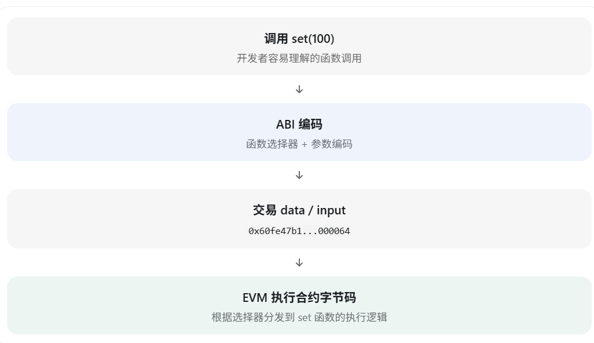
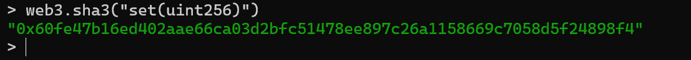
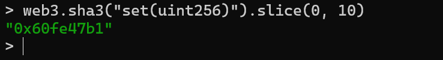
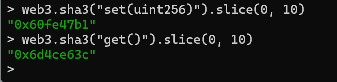
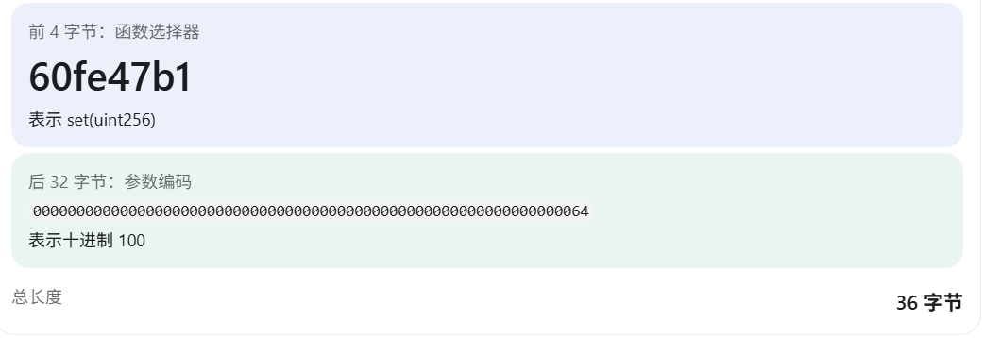

# 第 9 章 ABI、函数选择器与交易数据编码

上一章追踪了 `Storage.get()` 中的 `SLOAD`。但 Geth 收到一段十六进制调用数据后，合约如何知道应执行 `get()`，还是前面用过的 `set(100)`？本章继续使用同一个 `Storage` 合约，从函数选择器和参数编码入手，最后拆解一次真实交易的 `input`。

## ABI 规定了什么？

在这个合约中，我们已经使用过两种调用：

```solidity
contract Storage {
    uint256 private number;

    function set(uint256 _number) public {
        number = _number;
    }

    function get() public view returns (uint256) {
        return number;
    }
}
```

| Solidity 调用 | 调用数据的组成 |
| --- | --- |
| `set(100)` | `0x60fe47b1` + 参数 `100` 的 ABI 编码 |
| `get()` | 只有 `0x6d4ce63c` |

这两个开头的四字节值是**函数选择器**。Solidity ABI（Application Binary Interface，应用二进制接口）规定外部调用如何编码函数及参数、如何解释返回数据。它是合约交互时遵循的格式约定；部署到链上的仍是编译后的 EVM 字节码，而不是 ABI 文本。编译器生成的函数分发逻辑会读取调用数据的开头，选择相应的执行路径。[Solidity ABI 规范](https://docs.soliditylang.org/en/latest/abi-spec.html)定义了这些编码规则。



## 四字节函数选择器从哪里来？

按照 [ABI 规范中的函数选择器规则](https://docs.soliditylang.org/en/latest/abi-spec.html#function-selector)，取函数签名的 Keccak-256 哈希的前四字节：


`set(uint256 _number)` 的规范函数签名是 `set(uint256)`：只保留函数名和参数类型，不包含参数名、`public`、`external` 或返回值类型。因此，把参数名 `_number` 改成 `value`，或者在合适的合约接口中把可见性从 `public` 改为 `external`，不会改变这个函数的选择器；改变函数名或参数类型则会改变签名。

在 Geth JavaScript 控制台中，可以亲自计算：

```javascript
web3.sha3("set(uint256)")
```



结果是 32 字节哈希。虽然这个旧版控制台方法叫 `sha3`，这里计算的是以太坊使用的 **Keccak-256**，不是标准化的 SHA3-256；[Ethereum JSON-RPC 文档](https://ethereum.org/developers/docs/apis/json-rpc/#web3_sha3)也作了这一区分。

再取前四字节：

```javascript
web3.sha3("set(uint256)").slice(0, 10)
```



预期得到 `0x60fe47b1`。这里截取 10 个字符，是因为 `0x` 占 2 个字符，后面 8 个十六进制字符表示 4 字节。同样计算 `get()`：

```javascript
web3.sha3("get()").slice(0, 10)
```



预期得到 `0x6d4ce63c`。这些选择器由函数签名决定；使用相同签名的读者不需要把它们换成自己的交易哈希。

## `set(100)` 的参数怎样编码？

第 7 章曾手动构造调用数据：

```javascript
var callData = "0x60fe47b1" + "64".padStart(64, "0")
```



`0x60fe47b1` 是四字节选择器；`100` 的十六进制表示是 `64`，作为 `uint256` 参数被左侧补零到 32 字节。两段合起来是 **36 字节**，开头的 `0x` 只是十六进制字符串前缀，不计入字节长度。这里只是一个静态参数的简单例子；[ABI 规范](https://docs.soliditylang.org/en/latest/abi-spec.html#formal-specification-of-the-encoding)对动态类型还规定了偏移量和数据区域。

## 为什么 `get()` 只有选择器？

`get()` 没有输入参数，所以调用数据只有四字节选择器 `0x6d4ce63c`。它的返回值是另一回事：如果 Slot 0 存着 `100`，`eth.call` 返回的是按 ABI 编码的 `uint256`，即末尾为 `64` 的 32 字节数据：

```text
0x0000000000000000000000000000000000000000000000000000000000000064
```

函数调用的输入编码与函数执行后的返回值编码是两个相关但不同的过程。下一节会从已发送的 `set(100)` 交易中，把选择器和参数再拆出来核对。
