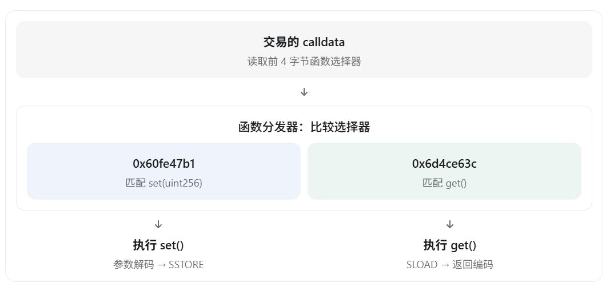
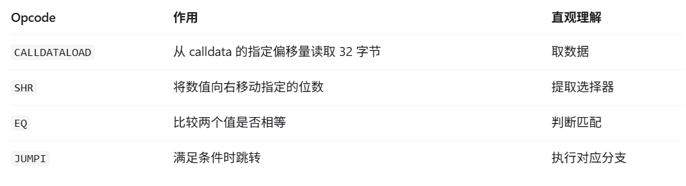
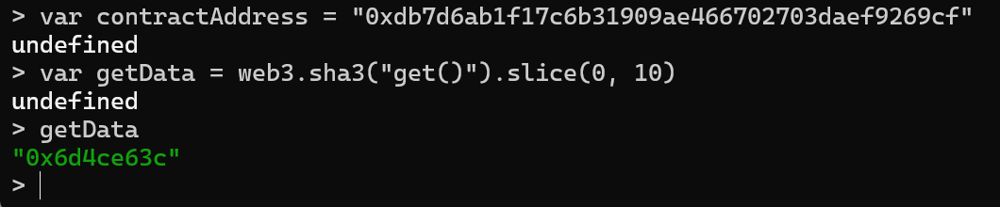
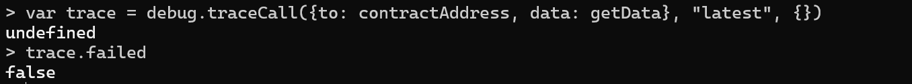
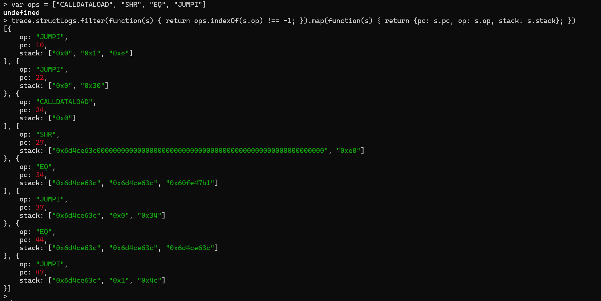
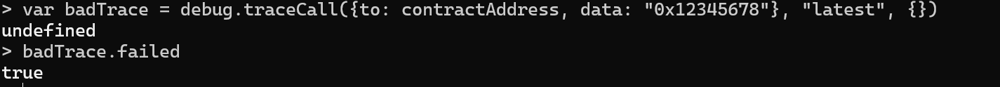
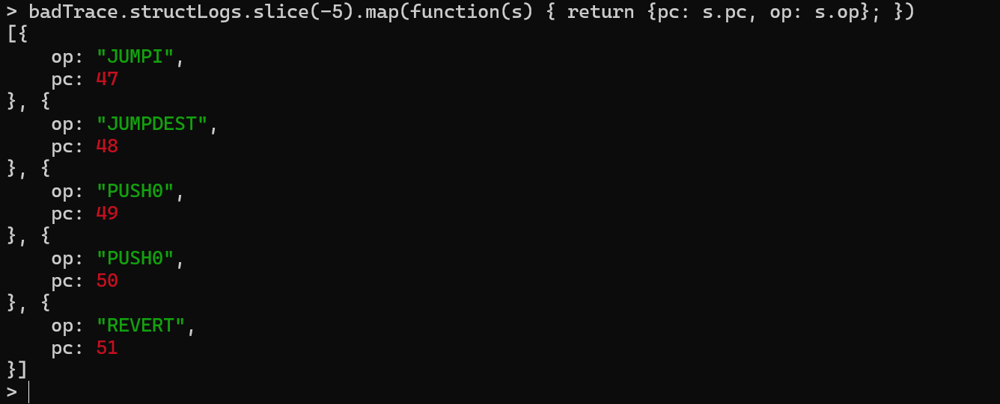

# 第 10 章 EVM 如何找到并执行正确的合约函数

上一课我们学习了 ABI 编码，知道 `set(100)` 会被转换成：

```text
0x60fe47b10000000000000000000000000000000000000000000000000000000000000064
```

其中，`0x60fe47b1` 是 `set(uint256)` 的函数选择器，后面 32 字节是参数 `100` 的 ABI 编码。

但现在出现一个新问题：既然 EVM 收到的只是一串字节，它怎么知道应该运行 `set()`，而不是 `get()`？

答案是：**合约字节码中的函数分发器（Function Dispatcher）**。

## 理解函数分发器

继续使用前面部署的 `Storage` 合约，它有两个公开函数：

```solidity
contract Storage {
    uint256 private number;

    function set(uint256 _number) public {
        number = _number;
    }

    function get() public view returns (uint256) {
        return number;
    }
}
```

编译后，合约运行时代码中会有一段函数分发逻辑。它读取 `calldata` 开头的 4 字节，与合约支持的函数选择器比较，然后跳转到对应的代码位置。选择器的计算方法见[第 9 章](09-abi-function-selectors-and-calldata.md)；[Solidity ABI 规范](https://docs.soliditylang.org/en/latest/abi-spec.html#function-selector)也规定了调用数据的前 4 字节用于指定函数。



图中的 `set()` 和 `get()` 是两条不同的执行路径。

## 函数分发器中的四条核心指令

先看四条关键指令（具体语义可对照[以太坊操作码参考](https://ethereum.org/developers/docs/evm/opcodes/)）：



### 第一步：CALLDATALOAD

例如传入：

```text
0x60fe47b10000000000000000000000000000000000000000000000000000000000000064
```

执行：

```text
PUSH0
CALLDATALOAD
```

`PUSH0` 将偏移量 `0` 压入栈。`CALLDATALOAD` 从 `calldata` 的第 0 字节开始读取 **32 字节**，得到：

```text
0x60fe47b100000000000000000000000000000000000000000000000000000000
```

注意：这还不是单独的 4 字节选择器。参数 `100` 编码的最后一个字节是 `0x64`，位于整段调用数据的第 36 字节，不在这次读取的前 32 字节中。

### 第二步：SHR

为了取出前 4 字节，需要把读到的 256 位数据右移 **224 位**。为什么是 224？因为 `256 − 4 × 8 = 224`。

因此执行：

```text
PUSH1 0xe0
SHR
```

`0xe0` 是十进制的 `224`。右移之后得到：

```text
0x60fe47b1
```

### 第三步：EQ

EVM 将提取出的选择器与合约中已知的选择器比较：

```text
0x60fe47b1 == 0x60fe47b1
```

`EQ` 返回 `1`，表示相等。

### 第四步：JUMPI

`JUMPI` 根据栈中的条件和跳转目标决定是否改变程序计数器 `PC`。如果条件不为零，就跳到指定的 `JUMPDEST`，进入匹配函数的执行路径。

以下是概念化逻辑，不是 Solidity 编译器生成的原始代码：

```javascript
if (selector === "0x60fe47b1") {
  // 执行 set(uint256)
} else if (selector === "0x6d4ce63c") {
  // 执行 get()
} else {
  // 没有匹配函数，且没有可处理它的 fallback 时，调用失败
}
```

这就是函数分发器的工作原理。这里的指令顺序用于解释原理；实际编译得到的指令可能因编译器版本或优化设置而不同。接下来用 Geth 的真实轨迹观察一次 `get()` 调用。

## 实验：在 Geth 中找到函数分发器

### 第一步：准备合约地址和调用数据

进入 Geth JavaScript 控制台，使用第 7 章部署的 `Storage` 合约地址。把 `contractAddress` 设为**你自己部署的合约地址**；截图中的 `0xdb7d…` 是作者的实验地址，不能直接照抄：

```javascript
var contractAddress = "填入你自己部署的合约地址"
```

可以先检查地址上是否有代码：

```javascript
eth.getCode(contractAddress)
```

若返回 `"0x"`，应检查是否连接了原来的开发链，以及数据目录和合约地址是否正确。然后通过函数签名计算 `get()` 的选择器：

```javascript
var getData = web3.sha3("get()").slice(0, 10)
getData
```



结果应为 `0x6d4ce63c`。`get()` 没有输入参数，所以这也是完整的调用数据；这个选择器由函数签名决定，不需要替换。

### 第二步：追踪 EVM 执行

执行：

```javascript
var trace = debug.traceCall(
  {to: contractAddress, data: getData},
  "latest",
  {}
)
trace.failed
```



预期 `trace.failed` 返回 `false`，表示**这次模拟调用**没有失败；`debug.traceCall` 不会把它作为新交易写入链上。用法见 [Geth 的 `debug_traceCall` 文档](https://geth.ethereum.org/docs/interacting-with-geth/rpc/ns-debug#debug_tracecall)。

### 第三步：观察前 25 条 EVM 指令

执行：

```javascript
trace.structLogs.slice(0, 25).map(function(s) {
  return {pc: s.pc, op: s.op, stack: s.stack}
})
```

留意 `CALLDATASIZE`、`CALLDATALOAD`、`SHR`、`EQ` 和 `JUMPI`。`CALLDATASIZE` 取得输入数据的字节数，可能用于先检查输入长度。`pc` 是程序计数器，`op` 是操作码，`stack` 是栈内容。前 25 步不一定包含完整分发过程，所以还要做下一步。

### 第四步：只查看函数分发的关键指令

为了不被大量日志干扰，从完整轨迹中筛选：

```javascript
var ops = ["CALLDATALOAD", "SHR", "EQ", "JUMPI"]
trace.structLogs.filter(function(s) {
  return ops.indexOf(s.op) !== -1
}).map(function(s) {
  return {pc: s.pc, op: s.op, stack: s.stack}
})
```



结合截图中的 `pc` 和 `stack`，可以沿着 `CALLDATALOAD` → `SHR` → `EQ` → `JUMPI` 还原这次调用的分发过程。`getData` 只有 4 字节，读取 32 字节时其余位置会补零。轨迹中也可能有用于其他检查的 `JUMPI`，不能把每个跳转都当作函数匹配。不同编译设置下，`pc` 和分支顺序也可能不同。[Geth 的基础追踪文档](https://geth.ethereum.org/docs/developers/evm-tracing/basic-traces)介绍了逐条操作码记录。

## 如果输入错误的选择器会怎样？

如果调用数据开头的选择器找不到对应函数，执行路径取决于合约是否定义了能够处理它的 `fallback` 函数。本章的 `Storage` 合约没有定义 `fallback`，因此可以用一个错误选择器观察回退路径；其他合约未必会得到相同结果。[Solidity 文档中的 `fallback` 说明](https://docs.soliditylang.org/en/latest/contracts.html#fallback-function)解释了这种特殊函数何时被调用。

仍使用上面的 `contractAddress`，模拟发送 `0x12345678`：

```javascript
var badTrace = debug.traceCall(
  {to: contractAddress, data: "0x12345678"},
  "latest",
  {}
)
badTrace.failed
```



本次实验返回 `true`。这表示**模拟执行失败**，不是某笔已上链交易的回执。查看轨迹末尾：

```javascript
badTrace.structLogs.slice(-5).map(function(s) {
  return {pc: s.pc, op: s.op}
})
```



截图中最后一条指令是 `REVERT`：运行时代码没有找到匹配的函数入口，也没有可接收这段数据的 `fallback`，于是撤销本次调用。不同编译版本下，末尾的其他指令和 `pc` 数值可能不同，重点是结合 `failed` 与执行路径判断结果。

至此可以把两件事连起来：ABI 规则决定调用数据怎样编码；EVM 则执行合约的运行时代码，由其中的分发逻辑读取选择器、比较并跳转。**EVM 不会凭函数名直接调用 Solidity 函数。**

## 章节自测

先试着自己回答，再对照参考答案。

### 题目

1. 节点怎样找到 `Storage` 合约？合约怎样选中 `get()`？
2. `get()` 只有 4 字节调用数据，`CALLDATALOAD` 读取 32 字节时会怎样？为什么还要 `SHR`？
3. 为什么右移 224 位？`EQ` 和 `JUMPI` 各做什么？
4. `debug.traceCall` 得到 `trace.failed === false` 说明什么？会产生链上交易吗？
5. 未知选择器 `0x12345678` 在没有 `fallback` 的 `Storage` 合约中会怎样？
6. 筛出的每个 `JUMPI` 都代表跳入目标函数吗？

### 参考答案

1. 交易的 `to` 地址定位合约；节点加载该地址的运行时字节码。字节码中的函数分发逻辑读取 `input` 开头的 4 字节选择器，与编译时生成的选择器比较，匹配后进入对应函数。
2. 缺少的后 28 字节补零。选择器位于读取结果的高位，`SHR` 右移后把它提取出来。
3. 32 字节减去选择器的 4 字节，剩余 28 字节，即 `28 × 8 = 224` 位。`EQ` 比较两个值是否相等；`JUMPI` 根据条件决定是否跳到指定代码位置。一次比较不匹配时，分发器还可能继续检查其他函数。
4. 说明**这次模拟执行没有失败**；单凭它不能证明进入了哪个函数。`traceCall` 不新增链上交易，也不持久修改状态。
5. 本章实验中，`trace.failed` 为 `true`，轨迹以 `REVERT` 结束。如果合约有 `fallback`，则可能进入该函数；它是否成功取决于函数的执行结果。`fallback` 是函数，`REVERT` 是撤销调用的指令。
6. 不能。`JUMPI` 也可能用于输入长度检查等逻辑。要结合前后指令、栈中的条件值、`pc` 和跳转目标，才能判断它在这条轨迹中的作用。

---

上一章：[第 9 章 ABI、函数选择器与交易数据编码](09-abi-function-selectors-and-calldata.md)
