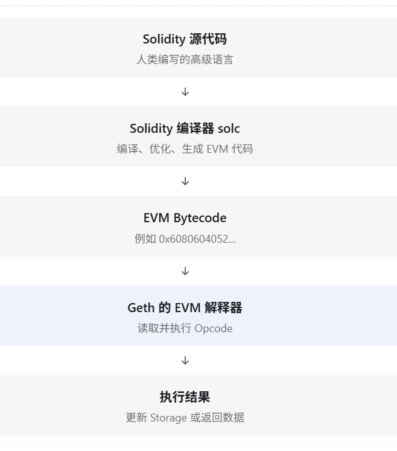
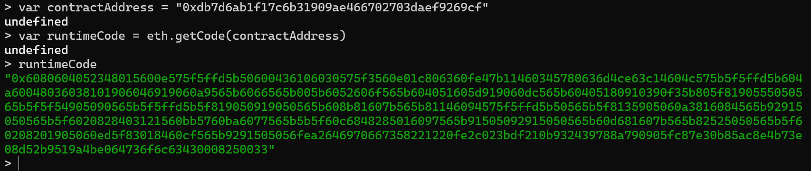
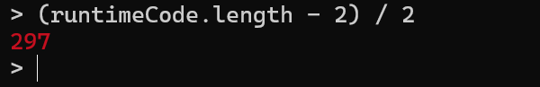

# 第 11 章 从 Solidity 源代码到 EVM 字节码

上一课，我们研究了 EVM 的函数分发机制（Function Dispatcher），理解了 `CALLDATALOAD`、`SHR`、`EQ` 和 `JUMPI` 如何帮助合约找到正确的函数。

今天我们再深入一层：**Solidity 写出来的智能合约，究竟是怎样变成 EVM 可以执行的字节码的？**

这也是我们从学习 EVM 基础，逐渐过渡到研究 Geth 源码的重要一步。

## Solidity 代码并不是直接在 EVM 中运行

之前编写的合约：

```solidity
// SPDX-License-Identifier: MIT
pragma solidity ^0.8.20;

contract Storage {
    uint256 private number;

    function set(uint256 _number) public {
        number = _number;
    }

    function get() public view returns (uint256) {
        return number;
    }
}
```

EVM 并不认识 `uint256`、`function`、`public` 这些 Solidity 语法。它只认识一个个字节构成的指令。



这里要区分两个角色：

1. **Solidity 编译器**：负责生成字节码。
2. **Geth**：负责在交易执行过程中按照 EVM 规则执行字节码。

Geth 并不需要读取 Solidity 源代码才能执行你的合约。

## 为什么存在两种合约字节码？

这是本节第一个重要知识点。之前在 Remix 编译合约时，可能注意到两个概念：

1. Creation Bytecode（部署字节码）
2. Runtime Bytecode（运行时字节码）

它们不是同一回事。

**Creation Bytecode** 在创建合约的交易中执行，负责初始化合约，并返回需要部署的运行时代码。它只在部署阶段执行。

**Runtime Bytecode** 在部署后保存在合约账户中，未来调用 `set()`、`get()` 时执行的就是这部分代码。它可以在后续交易和调用中重复执行。

[Solidity 官方文档](https://docs.soliditylang.org/en/latest/contracts.html#constructors)也说明：创建时执行初始化代码，最终保存在链上的代码不包含仅用于部署的构造逻辑。

## 实验一：读取链上的 Runtime Bytecode

我们继续使用前面部署的 `Storage` 合约。

### 第一步：连接 Geth 控制台

如果你的 Geth 节点仍在运行，使用此前的连接命令：

```bash
cd ~/ethereum/go-ethereum
./build/bin/geth attach ~/ethereum/dev-chain/geth.ipc
```

如果节点已经停止，需要先按[第 1 章](01-running-a-local-geth-dev-chain.md)的方式启动开发链，再连接控制台。

### 第二步：定义合约地址

在 Geth JavaScript 控制台执行，把引号中的内容替换为**你自己部署的合约地址**；截图中的地址只是作者的实验结果：

```javascript
var contractAddress = "填入你自己部署的合约地址"
```

### 第三步：读取合约运行时代码

```javascript
var runtimeCode = eth.getCode(contractAddress)
runtimeCode
```

你应该看到一串很长的十六进制字符：



这是链上保存的 EVM 运行时字节码。如果得到的只是 `"0x"`，先检查开发链和合约地址是否正确。

### 第四步：计算运行时代码的字节长度

执行：

```javascript
(runtimeCode.length - 2) / 2
```



为什么这样计算？因为 `0x` 是十六进制前缀，不是字节码内容；每两个十六进制字符表示一个字节。截图中的 `297` 是这次实验的结果，你的合约可能不同。

这里要注意，**字节长度不等于 EVM 指令数量**，因为像 `PUSH1`、`PUSH2` 等指令后面还会携带立即数。
