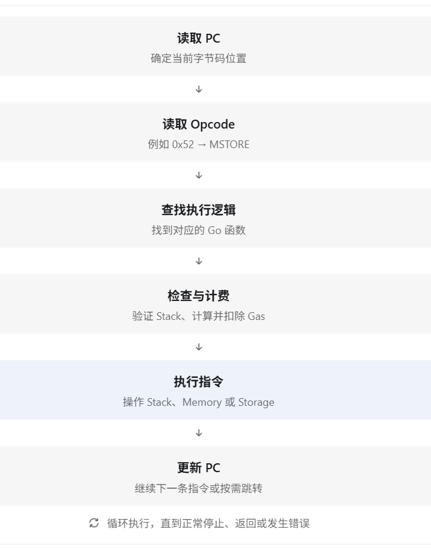
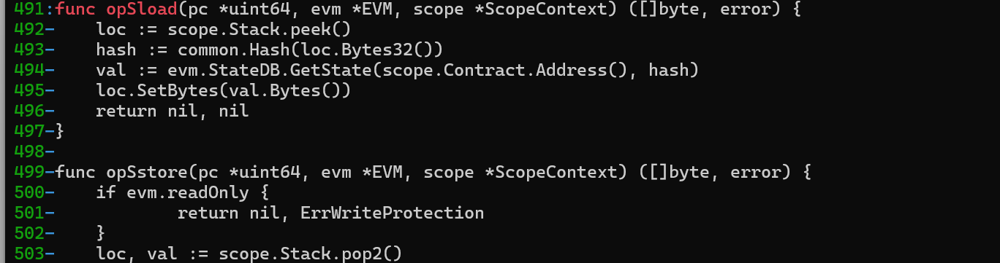
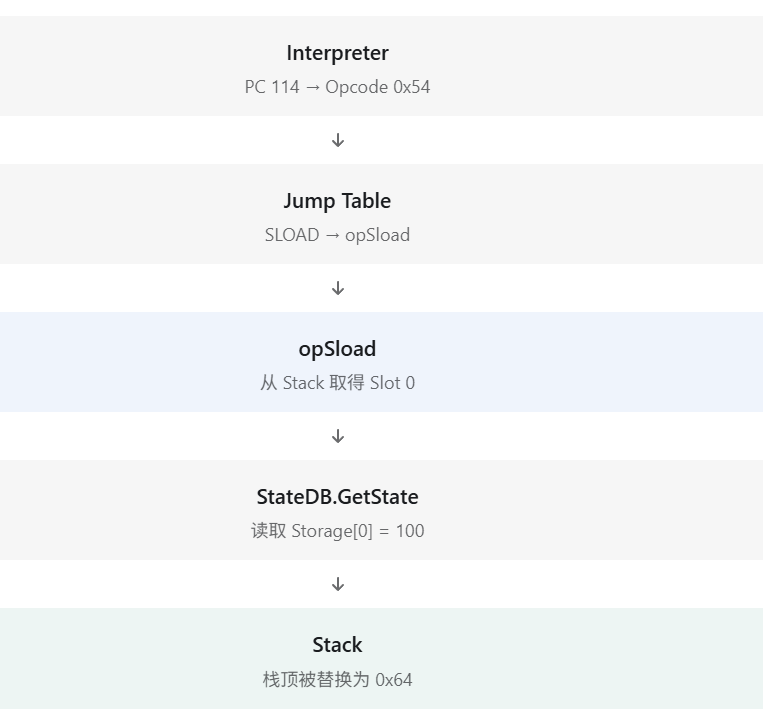
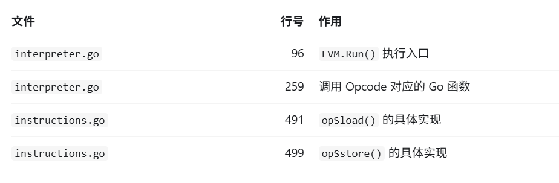
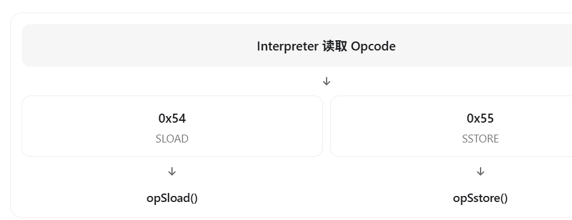
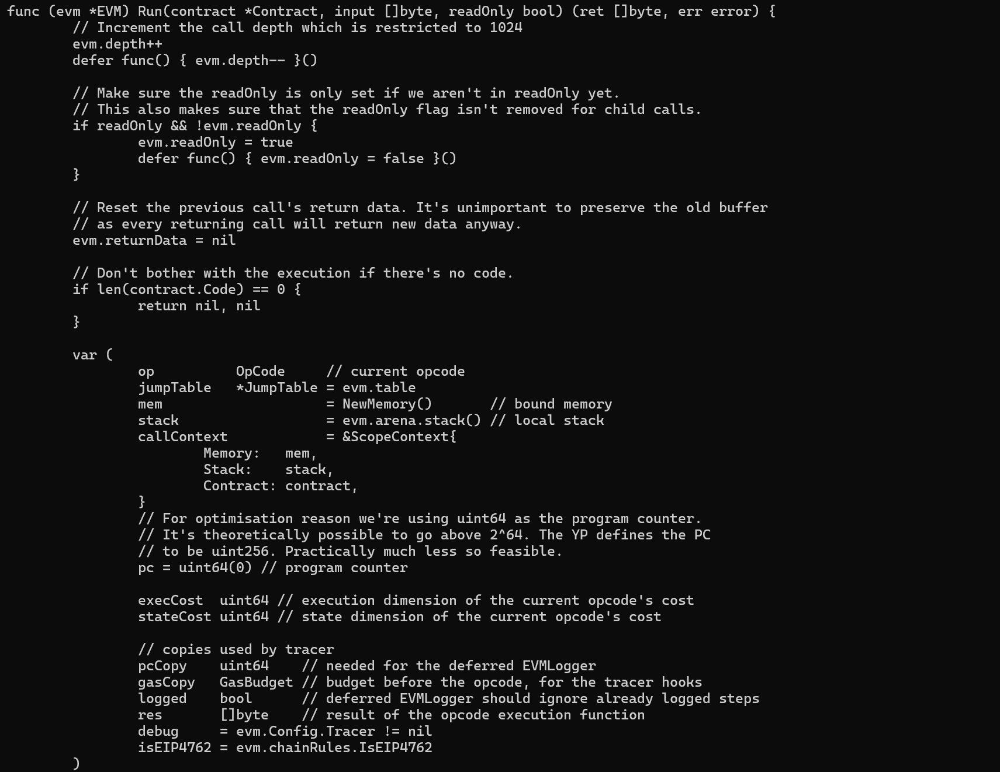
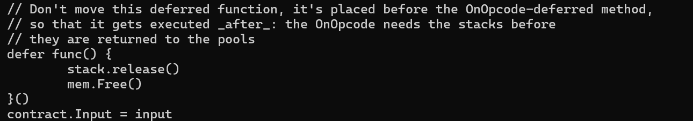

# 第 12 章 EVM Interpreter——Geth 如何执行智能合约？

## 12.1 阶段 A：找到 Interpreter 的整体结构

从这一课开始，我们正式进入 Go Ethereum 的 Go 源码。

前面的课程中，我们研究的是 Geth 的外部行为：发送交易，部署和调用智能合约，通过 `debug.traceCall()` 观察 EVM，研究 Stack、Memory、Storage 和 Opcode，以及读取 Runtime Bytecode。

但我们还没有回答一个重要的问题：**是谁在 Geth 内部执行 `PUSH1`、`MSTORE`、`SLOAD` 这些指令？**

答案就是 EVM Interpreter（解释器）。本节目标不是一次读懂所有源码，而是找到 Geth 执行 EVM 字节码的核心循环，理解它的基本工作机制。

### Geth 的 EVM 源码结构

作者本地使用的是 `v1.17.8-unstable-b10c4ecc`。相关源码主要位于：

```text
go-ethereum/
└── core/
    └── vm/
        ├── evm.go
        ├── interpreter.go
        ├── instructions.go
        ├── jump_table.go
        ├── stack.go
        ├── memory.go
        └── contract.go
```

这几个文件分别承担不同的职责：

| 文件 | 主要作用 |
| --- | --- |
| `evm.go` | 组织合约调用和 EVM 执行上下文 |
| `interpreter.go` | 执行 EVM 字节码 |
| `instructions.go` | 实现具体 Opcode |
| `jump_table.go` | 定义 Opcode 与执行函数等信息的映射 |
| `stack.go` | 实现 EVM Stack |
| `memory.go` | 实现 EVM Memory |
| `contract.go` | 保存当前合约执行所需的信息 |

可以对照 [Go Ethereum 的 `core/vm` 源码目录](https://github.com/ethereum/go-ethereum/tree/master/core/vm)。目录和实现会随版本变化，后面的行号也以你本地源码为准。

### Interpreter 的核心思想是什么？

上一课读取的 `Storage` 合约运行时代码，开头几个字节是 `60 80 60 40 52`，分别代表 `PUSH1 0x80`、`PUSH1 0x40`、`MSTORE`。我们已经知道这些指令的作用，但是 Geth 是 Go 编写的，它怎么执行这些字节？可以把执行过程理解成一个循环：



这就是 EVM Interpreter 的核心思想。

先用 Go 语言写一个简化版的伪代码：

```go
func Run(code []byte) {
    pc := 0
    for pc < len(code) {
        op := code[pc]
        switch op {
        case 0x01:
            // 执行 ADD
        case 0x52:
            // 执行 MSTORE
        case 0x54:
            // 执行 SLOAD
        }
        pc++
    }
}
```

这个示例只是为了帮助理解，不是 Geth 的真实源码。它还缺少很多机制：

- `PUSH1` 后面紧跟着立即数，不能简单让 PC 每次只加 1；
- `JUMP` 和 `JUMPI` 可以修改 PC；
- 执行 Opcode 之前需要检查 Stack 并计算 Gas；
- `RETURN`、`STOP`、`REVERT` 等指令会结束执行。

真实 Geth 的解释器正是要处理这些问题。

### Jump Table：Opcode 如何找到对应的 Go 函数？

假设 EVM 读取到 `0x54`，这个字节对应 `SLOAD`，但它怎么知道应该执行哪个 Go 函数？Geth 有一套 Opcode 分发表（Jump Table）。可以简单理解为：

```text
0x01 → opAdd
0x52 → opMstore
0x54 → opSload
0x55 → opSstore
```

其中，`0x01` 是 `ADD`，`0x52` 是 `MSTORE`，`0x54` 是 `SLOAD`，`0x55` 是 `SSTORE`。Jump Table 不只保存函数对应关系，还包含 Gas、Stack 使用要求等指令元信息。它使 Geth 不必为每条指令重新理解 Solidity 源代码，而是根据 Opcode 找到实现逻辑并执行。

### ScopeContext：执行时的数据放在哪里？

之前通过 Trace 观察过：

```javascript
{pc: 114, op: "SLOAD", stack: ["0x6d4ce63c", "0x52", "0x0", "0x0"]}
```

这些 Stack 数据在 Geth 的 Go 源码中是怎样组织的？Geth 中有一个叫 `ScopeContext` 的结构体，核心字段是：

```go
type ScopeContext struct {
    Memory   *Memory
    Stack    *Stack
    Contract *Contract
}
```

`Memory` 是当前调用帧的内存，`Stack` 是当前调用帧的栈，`Contract` 保存当前执行合约的上下文信息，包括代码和调用输入。执行 `MSTORE` 时需要访问 Memory 和 Stack；执行 `SLOAD` 时还需要通过 EVM 访问合约状态。因此可以把 `ScopeContext` 理解成将当前调用主要运行数据组织在一起的结构体。

### 阅读你本地的 Geth 源码

以下命令都在 WSL Ubuntu 终端中执行，**不是**在 Geth JavaScript 控制台。

**第一步：进入源码目录。**

```bash
cd ~/ethereum/go-ethereum
git rev-parse --short HEAD
```

作者本地的提交是 `b10c4ecc`；你的源码若没有切换到相同提交，行号或实现可能不同，不必强求一致。

**第二步：找到解释器文件和入口。**

```bash
ls core/vm/interpreter.go
grep -nE '^func .* Run\(' core/vm/interpreter.go
```


这里 `grep -n` 会显示行号，`-E` 启用扩展正则表达式；`^func` 寻找以 `func` 开头的函数定义，`Run` 是要找的执行函数。作者版本的入口位于第 96 行，是 `func (evm *EVM) Run(...)`。不同版本可能使用 `EVM.Run` 或 `EVMInterpreter.Run` 等组织方式，请以本地输出为准。

**第三步：寻找 Opcode 执行逻辑。**

```bash
grep -n 'operation.execute' core/vm/interpreter.go
```


作者版本的第 259 行是：

```go
res, err = operation.execute(&pc, evm, callContext)
```

这表示调用当前 Opcode 对应的执行函数。新版 Geth 可能有不同的执行路径，所以仍要以本地源码为准。

**第四步：找到真正的 `SLOAD` 实现。**

```bash
grep -n 'func opSload' core/vm/instructions.go
grep -n -A 12 'func opSload' core/vm/instructions.go
```




`-A 12` 表示同时显示匹配位置之后的 12 行。作者版本中，`opSload` 的核心逻辑是：

```go
loc := scope.Stack.peek()
hash := common.Hash(loc.Bytes32())
val := evm.StateDB.GetState(scope.Contract.Address(), hash)
loc.SetBytes(val.Bytes())
```

| Go 代码 | 作用 |
| --- | --- |
| `scope.Stack.peek()` | 获取栈顶的存储槽编号 |
| `loc.Bytes32()` | 把槽编号表示为 32 字节 |
| `evm.StateDB.GetState(...)` | 读取合约对应存储槽的值 |
| `loc.SetBytes(...)` | 将读取结果放回栈顶 |

`SLOAD` 并不是直接使用 Go 的 `map` 读取某个数字，而是通过 `StateDB` 访问合约状态。这会把我们引向后续的 StateDB、状态树和数据库设计。

### 把源码与之前的实验连接起来

还记得[第 8 章](08-evm-stack-memory-and-storage.md)的实验吗？

```javascript
readTrace.structLogs.filter(function(step) {
  return step.op === "SLOAD"
})
```

当时看到 `PC: 114`、`Opcode: SLOAD`、栈顶 `0x0`，读取 `Storage[0]` 得到 `0x64`（十进制 100）。现在可以从源码层面解释这条路径：



这就是从 Solidity 实验进入 Geth 源码的第一条完整路径。作者在本地找到的三个关键位置如下；行号只对应作者版本：



### 先理解找到的三段源码

**1. `EVM.Run()`：解释器入口。**

```go
func (evm *EVM) Run(contract *Contract, input []byte, readOnly bool) (ret []byte, err error) {
```

`evm *EVM` 是当前 EVM 实例；`contract *Contract` 是当前执行的合约上下文；`input []byte` 是传入的 calldata；`readOnly` 表示是否禁止状态修改；`ret` 是返回数据，`err` 是执行错误。现在可以把 `Run()` 理解为合约字节码的执行入口。

**2. `operation.execute()`：执行具体指令。**

```go
res, err = operation.execute(&pc, evm, callContext)
```

在作者版本中，这行位于第 259 行。它把当前 Opcode 对应的操作交给 Go 函数执行：



这是一张概念图。真实的 Opcode 查询、Stack 检查和 Gas 计费是在执行循环的其他部分完成的。

**3. `opSload()`：读取合约存储。**

```go
func opSload(pc *uint64, evm *EVM, scope *ScopeContext) ([]byte, error) {
    loc := scope.Stack.peek()
    hash := common.Hash(loc.Bytes32())
    val := evm.StateDB.GetState(scope.Contract.Address(), hash)
    loc.SetBytes(val.Bytes())
    return nil, nil
}
```

我们逐行看：`peek()` 获取栈顶元素但不立即弹出；这次实验的栈顶 `0x0` 是 Storage Slot 0。`common.Hash(loc.Bytes32())` 把槽编号转成 32 字节的键。`StateDB.GetState` 根据合约地址和槽编号读取值；作者实验的结果是 `0x64`。最后，`loc.SetBytes(val.Bytes())` 把读取结果写回原来的栈顶位置，替换之前的 Slot 编号。


所以 `SLOAD` 不只是“返回一个值”，它还会修改 EVM 栈顶，把读取结果交给后续 Opcode 使用。

### 第一次阅读真正的 Interpreter 主循环

我们已经找到 `operation.execute(&pc, evm, callContext)`，但还有几个问题：`pc` 在哪里定义和更新？`operation` 从哪里来？Stack 在执行前怎样检查？Gas 何时扣除？指令执行失败后如何处理？

回到 `interpreter.go` 的 `Run()` 函数。先在 Ubuntu 终端执行：

```bash
cd ~/ethereum/go-ethereum
sed -n '96,150p' core/vm/interpreter.go
```





重点寻找 `pc`（程序计数器）、`stack`（执行栈）、`mem`（执行内存）和 `callContext`（调用上下文）。接着执行：

```bash
sed -n '150,270p' core/vm/interpreter.go
```

这段源码较长，先不要急着记住每一行。沿着它找到读取 Opcode、检查 Stack、计算 Gas、执行指令、更新 PC 的顺序；下一阶段再逐项消化。`96`、`150`、`270` 都是作者版本的行号，如果本地版本不同，请先用前面的 `grep` 定位 `Run()`。
