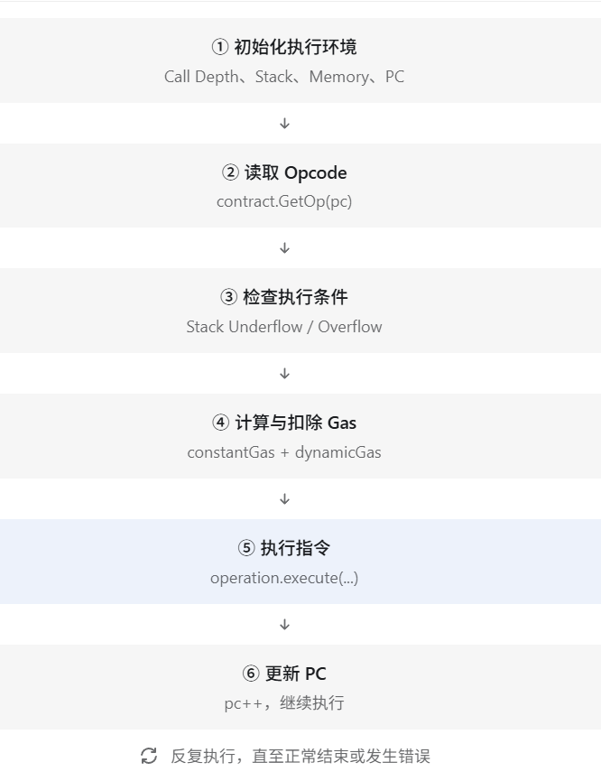

# 第 12 章 EVM Interpreter——Geth 如何执行智能合约？

## 12.1 阶段 A：找到 Interpreter 的整体结构

从这一课开始，我们正式进入 Go Ethereum 的 Go 源码。

前面的课程中，我们研究的是 Geth 的外部行为：

- 发送交易；
- 部署和调用智能合约；
- 通过 `debug.traceCall()` 观察 EVM；
- 研究 Stack、Memory、Storage 和 Opcode；
- 读取 Runtime Bytecode。

但我们还没有回答一个重要的问题：**是谁在 Geth 内部执行 `PUSH1`、`MSTORE`、`SLOAD` 这些指令？**

答案就是 EVM Interpreter（解释器）。本节目标不是一次读懂所有源码，而是找到 Geth 执行 EVM 字节码的核心循环，理解它的基本工作机制。

### Geth 的 EVM 源码结构

作者本地使用的是 `v1.17.8-unstable-b10c4ecc`。相关源码主要位于：

```text
go-ethereum/
└── core/
    └── vm/
        ├── evm.go
        ├── interpreter.go
        ├── instructions.go
        ├── jump_table.go
        ├── stack.go
        ├── memory.go
        └── contract.go
```

这几个文件分别承担不同的职责：

| 文件 | 主要作用 |
| --- | --- |
| `evm.go` | 组织合约调用和 EVM 执行上下文 |
| `interpreter.go` | 执行 EVM 字节码 |
| `instructions.go` | 实现具体 Opcode |
| `jump_table.go` | 定义 Opcode 与执行函数等信息的映射 |
| `stack.go` | 实现 EVM Stack |
| `memory.go` | 实现 EVM Memory |
| `contract.go` | 保存当前合约执行所需的信息 |

可以对照 [Go Ethereum 的 `core/vm` 源码目录](https://github.com/ethereum/go-ethereum/tree/master/core/vm)。目录和实现会随版本变化，后面的行号也以你本地源码为准。

### Interpreter 的核心思想是什么？

我们之前读取了 `Storage` 合约的运行时代码。它的前几个字节是 `60 80 60 40 52`，分别代表：

```text
PUSH1 0x80
PUSH1 0x40
MSTORE
```

我们已经知道这些指令的作用，但是 Geth 是 Go 编写的，它怎么执行这些字节？可以把执行过程理解成一个循环：


这就是 EVM Interpreter 的核心思想。

先用 Go 语言写一个简化版的伪代码：

```go
func Run(code []byte) {
    pc := 0
    for pc < len(code) {
        op := code[pc]
        switch op {
        case 0x01:
            // 执行 ADD
        case 0x52:
            // 执行 MSTORE
        case 0x54:
            // 执行 SLOAD
        }
        pc++
    }
}
```

这个示例只是为了帮助理解，不是 Geth 的真实源码。它还缺少很多机制：

- `PUSH1` 后面紧跟着立即数，不能简单让 PC 每次只加 1；
- `JUMP` 和 `JUMPI` 可以修改 PC；
- 执行 Opcode 之前需要检查 Stack 并计算 Gas；
- `RETURN`、`STOP`、`REVERT` 等指令会结束执行。

真实 Geth 的解释器正是要处理这些问题。

### Jump Table：Opcode 如何找到对应的 Go 函数？

假设 EVM 读取到 `0x54`。这个字节对应 `SLOAD`，但它怎么知道应该执行哪个 Go 函数？

Geth 有一套 Opcode 分发表（Jump Table）。你可以简单理解为：

```text
0x01 → opAdd
0x52 → opMstore
0x54 → opSload
0x55 → opSstore
```

其中，`0x01` 是 `ADD`，`0x52` 是 `MSTORE`，`0x54` 是 `SLOAD`，`0x55` 是 `SSTORE`。

Jump Table 不只是保存函数对应关系，还包含 Gas、Stack 使用要求等指令元信息。当前源码中的 `operation` 定义就包含执行函数及相关计费信息。这意味着 Geth 不需要为每一条指令重新理解一遍 Solidity 源代码，只需要根据 Opcode 找到实现逻辑并执行。

### ScopeContext：执行时的数据放在哪里？

之前通过 Trace 观察过：

```javascript
{pc: 114, op: "SLOAD", stack: ["0x6d4ce63c", "0x52", "0x0", "0x0"]}
```

这些 Stack 数据在 Geth 的 Go 源码中是怎样组织的？Geth 中有一个叫 `ScopeContext` 的结构体，核心字段是：

```go
type ScopeContext struct {
    Memory   *Memory
    Stack    *Stack
    Contract *Contract
}
```

这段结构在 Geth 源码中可以找到：

- `Memory *Memory`：当前调用帧的内存；
- `Stack *Stack`：当前调用帧的栈；
- `Contract *Contract`：当前执行合约的上下文信息，包括代码、调用输入等。

例如执行 `MSTORE` 时，需要访问 Memory 和 Stack；执行 `SLOAD` 时，还需要通过 EVM 访问合约状态。所以可以把 `ScopeContext` 理解成：将 EVM 当前一次调用所需要的主要运行数据组织在一起的结构体。

### 阅读你本地的 Geth 源码

以下命令都在 WSL Ubuntu 终端中执行，**不是**在 Geth JavaScript 控制台。

**第一步：进入源码目录。**

```bash
cd ~/ethereum/go-ethereum
```

确认当前提交：

```bash
git rev-parse --short HEAD
```

作者本地的提交是 `b10c4ecc`；你的源码若没有切换到相同提交，行号或实现可能不同，不必强求一致。

**第二步：找到解释器文件。**

```bash
ls core/vm/interpreter.go
```


再找到解释器入口：

```bash
grep -nE '^func .* Run\(' core/vm/interpreter.go
```


这里解释一下 `grep`：

- `-n`：显示匹配内容所在的行号；
- `-E`：允许使用扩展正则表达式；
- `^func`：寻找以 `func` 开头的函数定义；
- `Run`：我们要寻找的执行函数。

作者版本的入口位于第 96 行，是 `func (evm *EVM) Run(...)`。不同版本可能使用 `EVM.Run` 或 `EVMInterpreter.Run` 等组织方式，需要根据你本地的输出确认。

**第三步：寻找 Opcode 执行逻辑。**

```bash
grep -n 'operation.execute' core/vm/interpreter.go
```


作者版本的第 259 行是：

```go
res, err = operation.execute(&pc, evm, callContext)
```

这是一条特别重要的代码，它表示：调用当前 Opcode 对应的执行函数。注意，这只是作者版本中的一种实现路径；新版 Geth 可能存在不同的执行路径，所以必须以你的本地版本为准。

**第四步：找到真正的 `SLOAD` 实现。**

先执行：

```bash
grep -n 'func opSload' core/vm/instructions.go
```


然后：

```bash
grep -n -A 12 'func opSload' core/vm/instructions.go
```


`-A 12` 表示同时显示匹配位置之后的 12 行。作者版本中，`opSload` 的核心逻辑是：

```go
loc := scope.Stack.peek()
hash := common.Hash(loc.Bytes32())
val := evm.StateDB.GetState(scope.Contract.Address(), hash)
loc.SetBytes(val.Bytes())
```

| Go 代码 | 作用 |
| --- | --- |
| `scope.Stack.peek()` | 获取栈顶的存储槽编号 |
| `loc.Bytes32()` | 把槽编号表示为 32 字节 |
| `evm.StateDB.GetState(...)` | 读取合约对应存储槽的值 |
| `loc.SetBytes(...)` | 将读取结果放回栈顶 |

你应该会发现一个很有意思的地方：`SLOAD` 并不是直接使用 Go 的 `map` 读取某个数字，而是通过 `StateDB` 访问以太坊账户状态。这会把我们引向后续的 StateDB、状态树和数据库设计。

### 把源码与之前的实验连接起来

还记得[第 8 章](08-evm-stack-memory-and-storage.md)的实验吗？

```javascript
readTrace.structLogs.filter(function(step) {
  return step.op === "SLOAD"
})
```

当时看到：

```text
PC: 114
Opcode: SLOAD
Stack Top: 0x0
Storage[0]: 0x64
```

现在可以从源码层面解释这条路径：


这就是我们从 Solidity 实验进入 Geth 源码的第一条完整路径。我们已经在本地 Geth 源码中找到了三个关键位置；图中行号只对应作者版本：


### 先理解找到的三段源码

**1. `EVM.Run()`：解释器入口。**

```go
func (evm *EVM) Run(contract *Contract, input []byte, readOnly bool) (ret []byte, err error) {
```

逐个看入口参数和返回值：

- `evm *EVM`：当前 EVM 实例；
- `contract *Contract`：当前正在执行的合约上下文；
- `input []byte`：传入的 calldata；
- `readOnly bool`：是否禁止执行状态修改；
- `ret []byte`：执行返回的数据；
- `err error`：执行错误。

现在可以把 `Run()` 理解为合约字节码的执行入口。

**2. `operation.execute()`：执行具体指令。**

```go
res, err = operation.execute(&pc, evm, callContext)
```

在作者版本中，这行位于第 259 行。它把当前 Opcode 对应的操作交给 Go 函数执行：


这是一张概念图。真实的 Opcode 查询、Stack 检查和 Gas 计费是在执行循环的其他部分完成的。

**3. `opSload()`：读取合约存储。**

```go
func opSload(pc *uint64, evm *EVM, scope *ScopeContext) ([]byte, error) {
    loc := scope.Stack.peek()
    hash := common.Hash(loc.Bytes32())
    val := evm.StateDB.GetState(scope.Contract.Address(), hash)
    loc.SetBytes(val.Bytes())
    return nil, nil
}
```

我们逐行分析。

**第一行：读取栈顶。**

```go
loc := scope.Stack.peek()
```

`peek()` 获取栈顶元素，但不立即弹出。还记得之前的 EVM 追踪结果吗？

```text
op: SLOAD
stack: ["0x6d4ce63c", "0x52", "0x0", "0x0"]
```

栈顶是最后一个 `0x0`，代表这次要读取 Storage Slot 0。

**第二行：转换为存储槽的键。**

```go
hash := common.Hash(loc.Bytes32())
```

这里把栈顶的 256 位数值转换成 32 字节的存储槽标识。

**第三行：读取状态。**

```go
val := evm.StateDB.GetState(scope.Contract.Address(), hash)
```

这是这段代码中最重要的一行。它需要两个信息：

- `scope.Contract.Address()`：从哪个合约账户读取；
- `hash`：读取该账户的哪个 Storage Slot。

在作者的这次实验中，相当于从**作者部署的合约地址**读取 Slot 0，结果是 `0x64`（十进制 100）。你在自己的实验中必须使用**自己部署的合约地址**，不应照抄作者的地址。

**第四行：写回栈顶。**

```go
loc.SetBytes(val.Bytes())
```

这一步把读取到的存储值放入栈顶位置，替换掉之前的 Slot 编号。


所以 `SLOAD` 的实现不是简单地返回一个值，而是通过修改 EVM 栈顶，把读取结果交给后续 Opcode 使用。

### 第一次阅读真正的 Interpreter 主循环

我们已经知道：

```go
res, err = operation.execute(&pc, evm, callContext)
```

但是还不知道：

1. `pc` 在哪里定义和更新？
2. `operation` 从哪里来？
3. Stack 在执行前如何检查？
4. Gas 在什么时候扣除？
5. 指令执行失败后如何处理？

这些问题需要回到 `interpreter.go` 的 `Run()` 函数中寻找答案。

**第一步：查看 `Run()` 的初始化部分。**在 Ubuntu 终端执行：

```bash
cd ~/ethereum/go-ethereum
sed -n '96,150p' core/vm/interpreter.go
```


重点寻找：

- `pc`：程序计数器；
- `stack`：当前执行栈；
- `mem`：执行内存；
- `callContext`：调用上下文。

**第二步：查看指令执行循环。**接着执行：

```bash
sed -n '150,270p' core/vm/interpreter.go
```

在作者版本的输出里，先看到 `contract.Input = input`，然后进入 `for { ... }`。下面保留了本阶段要找的主线；为避免打断阅读，省略了调试追踪和 EIP-4762 条件分支。完整代码仍要以你自己终端的输出为准。

```go
contract.Input = input

for {
    op = contract.GetOp(pc)
    operation := jumpTable[op]
    execCost, stateCost = operation.constantGas, 0

    if sLen := stack.len(); sLen < operation.minStack {
        return nil, &ErrStackUnderflow{
            stackLen: sLen,
            required: operation.minStack,
        }
    } else if sLen > operation.maxStack {
        return nil, &ErrStackOverflow{
            stackLen: sLen,
            limit: operation.maxStack,
        }
    }

    if !contract.Gas.ChargeExecutionOnly(execCost) {
        return nil, ErrOutOfGas
    }

    var memorySize uint64
    if operation.dynamicGas != nil {
        if operation.memorySize != nil {
            memSize, overflow := operation.memorySize(stack)
            if overflow {
                return nil, ErrGasUintOverflow
            }
            if memorySize, overflow = math.SafeMul(toWordSize(memSize), 32); overflow {
                return nil, ErrGasUintOverflow
            }
        }

        var dynamicCost GasCosts
        dynamicCost, err = operation.dynamicGas(evm, contract, stack, mem, memorySize)
        execCost, stateCost = execCost+dynamicCost.ExecutionGas, dynamicCost.StateGas
        if err != nil {
            return nil, fmt.Errorf("%w: %v", ErrOutOfGas, err)
        }
        if dynamicCost.StateGas == 0 {
            if !contract.Gas.ChargeExecutionOnly(dynamicCost.ExecutionGas) {
                return nil, ErrOutOfGas
            }
        } else if !contract.Gas.charge(dynamicCost) {
            return nil, ErrOutOfGas
        }
    }

    if memorySize > 0 {
        mem.Resize(memorySize)
    }
    res, err = operation.execute(&pc, evm, callContext)
    if err != nil {
        break
    }
    pc++
}

if err == errStopToken {
    err = nil
}
return res, err
```

这段源码较长，先不要急着记住每一行。沿着它找到读取 Opcode、检查 Stack、计算 Gas、执行指令、更新 PC 的顺序；下一阶段再逐项消化。`96`、`150`、`270` 都是作者版本的行号，如果本地版本不同，请先用前面的 `grep` 定位 `Run()`。

## 12.2 阶段 B：消化 Interpreter 主循环

### 先理解整个 `Run()` 函数

现在我们找到了完整的 EVM Interpreter 主循环。源码虽然有一百多行，但可以分为六个阶段：初始化执行环境、读取 Opcode、检查 Stack、计算并扣除 Gas、执行指令、更新 PC。



以下以作者的 `v1.17.8-unstable-b10c4ecc` 源码为例。你本地的 Geth 版本若不同，行号和实现可能变化，请优先沿着实际代码中的变量与调用关系阅读。

### 第一阶段：初始化执行环境（作者版本约第 96～150 行）

**1. `evm.depth++`：记录调用深度。**

```go
evm.depth++
defer func() { evm.depth-- }()
```

这里的 `depth` 是 EVM 消息调用深度。例如合约 A 调用合约 B，B 又调用 C，就会进入多层调用。每进入一次 `Run()`，深度增加；退出时通过 `defer` 减少。

注意：它**不是** EVM Stack 的元素数量。以太坊执行模型对调用深度有 1024 层的限制，但这两行只是维护计数，并没有直接执行限制检查。

**2. `readOnly`：保持只读执行状态。**

```go
if readOnly && !evm.readOnly {
    evm.readOnly = true
    defer func() { evm.readOnly = false }()
}
```

这里有个很巧妙的设计：如果父调用已经进入只读状态，子调用不能随意取消这个限制。

此前在源码中看到的：

```go
if evm.readOnly {
    return nil, ErrWriteProtection
}
```

就是 `opSstore` 对只读限制的检查。因此，`STATICCALL` 中尝试执行 `SSTORE` 会被禁止。

**3. 创建 Stack 和 Memory。**

```go
mem = NewMemory()
stack = evm.arena.stack()

callContext = &ScopeContext{
    Memory:   mem,
    Stack:    stack,
    Contract: contract,
}
```

这两行对应我们前面学习的两个数据空间：

- `NewMemory()`：创建当前调用帧的 EVM Memory；
- `evm.arena.stack()`：取得当前执行所用的 Stack。

这两个数据结构都供当前调用使用，并不是合约的持久化 Storage。接下来 `callContext = &ScopeContext{ ... }` 就是 Go 结构体实例化，把三个执行时需要的数据对象组合在一起，方便 Opcode 的实现函数使用。

**4. 初始化 PC。**

```go
pc = uint64(0)
```

PC 是 Program Counter，表示当前准备执行的 Opcode 在合约字节码中的位置。之前的 Trace 就从 PC 0 开始：

```text
PC 0 → PUSH1
PC 2 → PUSH1
PC 4 → MSTORE
```

为什么不是 0、1、2？因为 `PUSH1` 指令会额外占用一个字节存放立即数。所以 PC 表示的是**字节码偏移量**，不是第几条指令。

### 第二阶段：读取 Opcode，查询 Jump Table

源码用 `for { ... }` 进入 Interpreter 主循环。这是 Go 的无限循环：不断读取下一条 EVM Opcode，执行，再进入下一轮。

循环里的第一组重要代码是：

```go
op = contract.GetOp(pc)
operation := jumpTable[op]
```

第一行 `contract.GetOp(pc)` 从当前合约的字节码中读取 PC 指向的 Opcode。第二行 `jumpTable[op]` 根据 Opcode 从 Jump Table 中取得该指令的执行信息。例如：

```text
Opcode 0x54
    ↓
SLOAD
    ↓
找到与 SLOAD 对应的 operation
```

`operation` 包含执行函数、Gas 成本和 Stack 约束等信息。这就实现了**字节码到 Go 函数的映射**。

### 第三阶段：检查 Stack 是否满足指令要求

作者版本的主循环会在调用执行函数前检查 Stack 长度：

```go
if sLen := stack.len(); sLen < operation.minStack {
    return nil, &ErrStackUnderflow{
        stackLen: sLen,
        required: operation.minStack,
    }
} else if sLen > operation.maxStack {
    return nil, &ErrStackOverflow{
        stackLen: sLen,
        limit: operation.maxStack,
    }
}
```

这是非常典型的虚拟机安全检查。例如 `ADD` 需要两个操作数，假设当前 Stack 只有一个数字：

```text
Stack: [5]
```

此时执行 `ADD` 就会发生 Stack Underflow（栈下溢）。反过来，如果执行指令会导致 Stack 超过容量，就可能出现 Stack Overflow（栈溢出）。Geth 在调用具体指令的执行函数之前，就会先检查这些条件。

这也说明：EVM 操作码不是直接拿来执行的，解释器还需要保证执行环境符合规则。

### 第四阶段：计算并扣除 Gas

作者版本先处理指令的固定 Gas 成本：

```go
execCost, stateCost = operation.constantGas, 0
if !contract.Gas.ChargeExecutionOnly(execCost) {
    return nil, ErrOutOfGas
}
```

随后，源码中的 `operation.dynamicGas != nil` 表示某些 Opcode 还有动态 Gas 成本。例如：

- `ADD` 的基础费用相对简单；
- `MSTORE` 可能涉及内存扩展费用；
- `SLOAD` 涉及存储槽访问费用；
- `SSTORE` 的费用还与存储槽状态有关。

本地源码还包含 `GasCosts`、`ExecutionGas`、`StateGas`。这说明该版本可以分别记录和扣除执行维度与状态维度的 Gas 成本。

但要注意：**这不意味着以前看到的交易 Gas Limit 已经可以简单理解成两个独立的用户输入值。**具体 Gas 模型还要结合该版本的 `GasBudget`、链规则和交易处理代码继续研究。目前先抓住“指令执行前需要计算并扣除 Gas”这条主线。

### 第五阶段：真正执行 Opcode

来到阶段 A 找到的作者版本第 259 行：

```go
res, err = operation.execute(&pc, evm, callContext)
```

这是整个执行循环中最关键的一行：

| 参数或结果 | 作用 |
| --- | --- |
| `&pc` | PC 的指针，允许指令修改执行位置 |
| `evm` | 当前 EVM 实例 |
| `callContext` | 当前调用的 Stack、Memory、Contract |
| `res` | 指令执行产生的返回数据 |
| `err` | 执行错误或停止信号 |

为什么传入的是 `&pc`，而不是 `pc`？因为某些指令需要改变程序执行位置，例如 `JUMP`、`JUMPI`。`PUSH1` 等指令还需要处理操作码后面的立即数。

### 第六阶段：处理结果并更新 PC

执行后，主循环检查结果并更新 PC：

```go
if err != nil {
    break
}
pc++
```

如果发生错误或停止信号，就退出循环。如果继续执行，则更新 PC。

但这里有一个容易产生误解的地方：代码写的是 `pc++`，为什么 `PUSH1` 执行后 PC 会从 0 变成 2？原因就在前面传入的 `&pc`。`PUSH1` 的执行函数会处理紧随操作码后的立即数，并相应调整 PC，然后主循环再执行 `pc++`。因此，两部分配合起来实现了正确的指令定位。

对于 `JUMP`，执行函数也需要按照主循环的 PC 更新规则设置跳转位置。

### 用教学伪代码把六个阶段连起来

下面不是 Geth 的原始源码，只是帮助记住主线：

```go
for {
    op := contract.GetOp(pc)
    operation := jumpTable[op]

    checkStack(operation)
    chargeGas(operation)

    result, err := operation.execute(&pc, evm, scope)
    if err != nil {
        break
    }
    pc++
}
```

至此，我们要通过源码理解：

1. EVM 如何读取当前 Opcode。
2. 如何通过 Jump Table 找到对应的 Go 实现。
3. 为什么执行之前需要检查 Stack。
4. Gas 为什么在指令执行前计费。
5. 为什么 Opcode 执行函数接收 PC 指针。
6. EVM 如何不断执行下一条指令。

---

上一章：[第 11 章 从 Solidity 源代码到 EVM 字节码](11-solidity-source-to-evm-bytecode.md)
